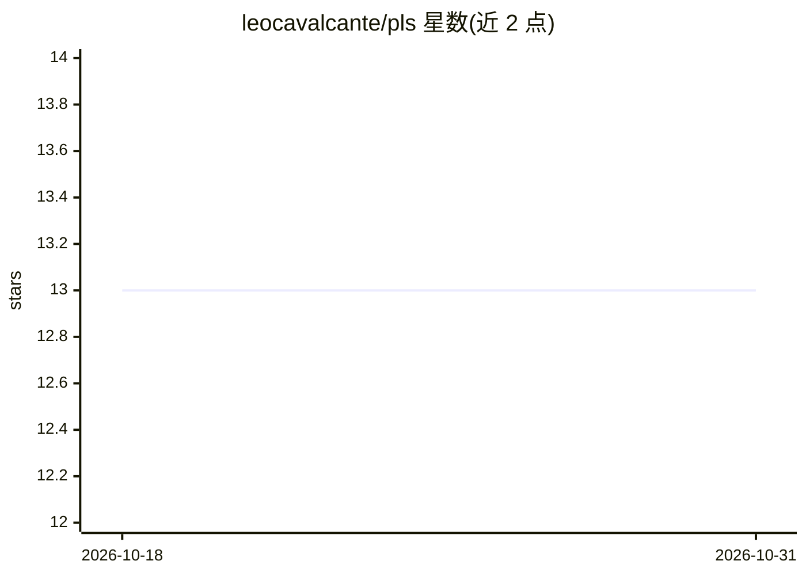

# leocavalcante/pls

⭐ 13 · TypeScript · BSD-3-Clause · 推送 2026-02-03 · [GitHub](https://github.com/leocavalcante/pls) · 个人维护

**面向 AI 编程代理的 PHP 语言服务器（LSP 3.17）**

用 TypeScript 实现的 PHP Language Server，实现 LSP 3.17 规范，以单一 Bun 可执行文件分发。内置自研递归下降解析器，无需 PHP 二进制。提供导航（定义跳转/引用/类型与调用层次）、补全、诊断、重命名重构与 PSR-4 感知的文件操作（重命名文件时自动更新命名空间、类名与 use 语句）。作者称其主要由 AI 代理以 vibe coding 方式构建，服务于 AI 编程代理（及人类）。提供 Linux/macOS/Windows 预编译二进制、VS Code 扩展与 Neovim 插件。

## 筛选速览

| 维度 | 判定 | 备注 |
|---|---|---|
| AI 角色 | `ai-enhanced` | 去掉 AI 部分产品仍成立 |
| 许可风险 | `permissive` | BSD-3-Clause |
| 部署形态 | `None` |  |
| 模型依赖 | — | README 未给出锁定关系 |
| 硬件要求 | — | 无带数字的原话,不猜 |
| 安装摩擦 | `low` | 无编译、无系统依赖或容器化 |
| 成熟度 | — | 结构信号不足 |

## 能力要点

- 单一 Bun 可执行文件分发，零外部依赖、无需 PHP 二进制
- 自研递归下降 PHP 解析器（词法/解析/AST）
- PSR-4 感知文件操作：重命名/移动文件自动更新命名空间与 use 语句
- 提供 VS Code 扩展（.vsix）与 Neovim 插件（lazy.nvim）

## 适用场景

- 在编辑器或 AI 编程代理中获得 PHP 项目的补全、跳转与诊断
- 重命名 PHP 文件时自动维护 PSR-4 命名空间与引用
- 通过 LSP 客户端以 pls --stdio 接入任意编辑器

## 场景标签

 · 领域:开发者工具/PHP

## 证据(README 行号)

> L3: > **P**HP **L**anguage **S**erver implementing LSP 3.17, built in TypeScript and distributed as a single Bun executa
> L7: Built primarily through **vibe coding** with AI agents to provide LSP support for AI coding agents working on PHP pr

## 星数曲线

2026-10-18 13 → 2026-10-31 13（+0）

---
*卡片 v1 · prompt 1.4 · 生成 2026-10-31 · 置信度 high · 依据 README sha `bc14c708f8d9` · [字段定义](../../DATASET.md)*
