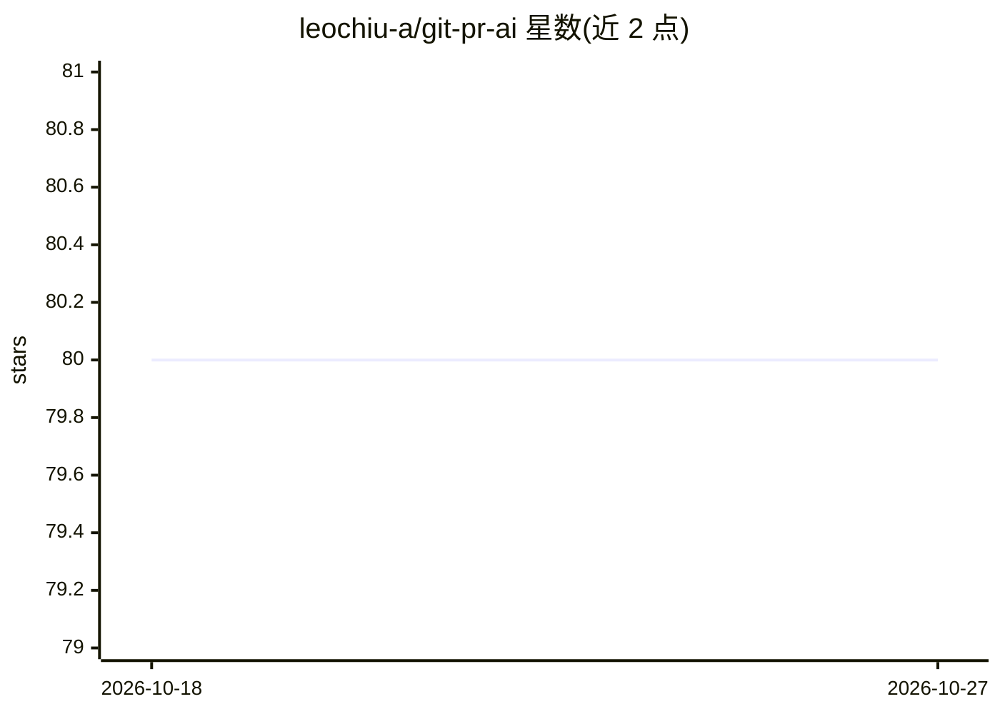

# leochiu-a/git-pr-ai

⭐ 80 · TypeScript · Apache-2.0 · 推送 2026-10-05 · [GitHub](https://github.com/leochiu-a/git-pr-ai) · [官网](https://leochiu-a.github.io/git-pr-ai) · 个人维护

**用 AI 辅助开发者完成 git 分支、提交与 PR 全流程的 CLI 工具**

面向开发者的 git 子命令集与 AI Agent Skills：注册 git pr-ai、create-branch、ai-commit、open-pr、pr-review、fix-pr-comments 等命令，从 JIRA 工单生成分支名、生成符合 conventional commit 格式的提交信息、撰写与更新 PR 描述、执行 AI 代码审查并自动修复评审意见。支持 GitHub/GitLab 平台，需先安装并认证 gh 或 glab CLI，并接入 Claude Code、Gemini CLI、Cursor Agent CLI 或 Codex CLI 之一作为 AI 提供方；也可通过 npx skills 安装为 Agent 技能用自然语言驱动。

## 筛选速览

| 维度 | 判定 | 备注 |
|---|---|---|
| AI 角色 | `ai-ecosystem` | LLM/agent 周边工具 |
| 许可风险 | `permissive` | Apache-2.0 |
| 部署形态 | `library` | 以包/库形式分发 |
| 模型依赖 | locked-api |  |
| 硬件要求 | — | 无带数字的原话,不猜 |
| 安装摩擦 | `low` | 无编译、无系统依赖或容器化 |
| 成熟度 | — | 结构信号不足 |

## 能力要点

- 以 git 子命令形式提供分支创建、AI 提交信息、PR 创建/描述更新/AI 审查/意见修复等命令
- 支持 GitHub/GitLab 与 Claude Code、Gemini CLI、Cursor CLI、Codex CLI 四种 AI 提供方
- 从 JIRA 工单自动生成语义化分支名并在提交信息中关联工单
- 可作为 AI Agent Skills 安装，用自然语言驱动完整 PR 工作流

## 适用场景

- 我想让 AI 根据代码变更生成规范的提交信息和 PR 描述
- 从 JIRA 工单一键创建命名一致的分支
- 让 AI 审查 PR 并自动修复评审意见后提交推送
- 把 PR 全流程交给 Claude Code 等 agent 用自然语言完成

## 场景标签

`代码审查` `编码 Agent` · 领域:编码与开发

## 证据(README 行号)

> L6: `git-pr-ai` streamlines GitHub/GitLab Pull Requests with AI-powered automation. Use it as **CLI commands** in your t
> L24: - **AI Provider**: Depending on your preference, set up access for one of the following AI providers:
> L33: |Platform|Claude Code|Gemini CLI|Cursor CLI|Codex CLI|

## 星数曲线

2026-10-18 80 → 2026-10-27 80（+0）

---
*卡片 v1 · prompt 1.4 · 生成 2026-10-24 · 置信度 high · 依据 README sha `801c28012b85` · [字段定义](../../DATASET.md)*
