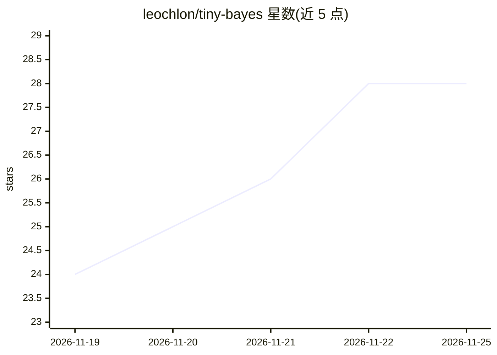

# leochlon/tiny-bayes

⭐ 28 · Lean · NOASSERTION · 推送 2026-11-18 · [GitHub](https://github.com/leochlon/tiny-bayes) · [官网](https://doi.org/10.5281/zenodo.24346623) · 组织维护

**用 Lean 4 为语言模型与神经 PDE 求解器提供核验证证明的科研库**

由 Hassana Labs 发布的 Lean 4 形式化项目：将 EleutherAI Pythia-14M（固定 revision，float16 精确解码）与一个 16 单元 tanh Poisson PINN 在 Lean 4 + Mathlib 中定义为数学函数，并对二者证明双侧界定理（如 32-token 提示下的 logit 差距下界、PINN 全区域误差上界与 witness 点下界），全部定理仅依赖三条核心公理。提供 lake 构建脚本与 check 工具，可重建目录并拒绝 sorry/axiom 等逃逸手段。依赖 Lean v4.27.0-rc1 与指定 Mathlib 版本，许可证为 CC BY-NC 4.0（禁止商用）。

## 筛选速览

| 维度 | 判定 | 备注 |
|---|---|---|
| AI 角色 | `ai-knowledge` | 知识聚合/清单类 |
| 许可风险 | `none` | NOASSERTION |
| 部署形态 | `None` |  |
| 模型依赖 | — | README 未给出锁定关系 |
| 硬件要求 | — | 无带数字的原话,不猜 |
| 安装摩擦 | `low` | 无编译、无系统依赖或容器化 |
| 成熟度 | — | 结构信号不足 |

## 能力要点

- 以 Lean 4 + Mathlib 形式化 Pythia-14M 的精确前向计算并证明 logit 定理
- 对 Poisson PINN 给出全区域误差上界与 witness 点下界的双侧证明
- check 工具可从零重建并拒绝 sorry/axiom/native_decide 等证明逃逸
- 每条定理仅依赖 propext、Classical.choice、Quot.sound

## 适用场景

- 复现或审查预训练语言模型的形式化保证
- 将核验证方法用于物理信息神经网络的误差认证
- 作为形式化验证与深度学习结合的教学/研究材料

## 场景标签

`科研工具` · 领域:学习与行业

## 证据(README 行号)

> L3: **Theorems, not tests.**
> L12: A trained checkpoint is a finite list of numbers, and those numbers determine one mathematical function. tiny-bayes

## 星数曲线

2026-11-19 24 → 2026-11-25 28（+4）

---
*卡片 v1 · prompt 1.4 · 生成 2026-11-19 · 置信度 high · 依据 README sha `6820823c37b4` · [字段定义](../../DATASET.md)*
