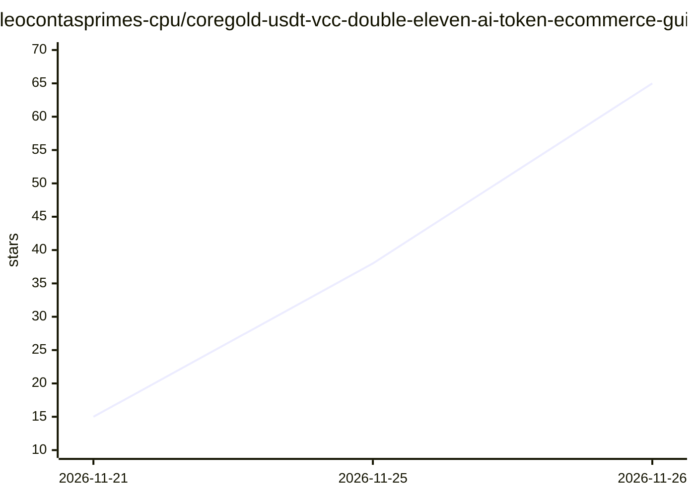

# leocontasprimes-cpu/coregold-usdt-vcc-double-eleven-ai-token-ecommerce-guide

⭐ 65 · 推送 2026-11-19 · [GitHub](https://github.com/leocontasprimes-cpu/coregold-usdt-vcc-double-eleven-ai-token-ecommerce-guide) · [官网](https://app.coregold.io/signup?invite_code=ADvlj9b) · 个人维护 · 中文 README

**面向电商与内容团队的虚拟卡（USDT 充值）开卡使用指南**

一篇以文章形式提供的指南，围绕 AI 工具订阅与海外软件采购场景，拆解旺季多平台工具付费中的用卡做法：按场景选卡段、保持账单地址一致、随用随充与冻结管理，并分四步给出 CoreGold 平台的注册、USDT（TRC20）充值、选择套餐与卡段、绑定 Apple Pay / Google Pay 的操作流程。面向跨境电商、社媒投放和内容创作团队。文中含注册引导链接，未见代码、安装方式或许可证信息。

## 筛选速览

| 维度 | 判定 | 备注 |
|---|---|---|
| AI 角色 | `ai-knowledge` | 知识聚合/清单类 |
| 许可风险 | `none` | — |
| 部署形态 | `None` |  |
| 模型依赖 | — | README 未给出锁定关系 |
| 硬件要求 | — | 无带数字的原话,不猜 |
| 安装摩擦 | `low` | 无编译、无系统依赖或容器化 |
| 成熟度 | — | 结构信号不足 |

## 能力要点

- CoreGold 开卡四步流程：注册、USDT 充值、选套餐卡段、绑卡
- 支持 TRON（TRC20）网络的 USDT 充值，提及 OKX、币安等交易平台
- 提供 AI 工具、Apple Pay / Google Pay、海外电商、广告投放等场景卡段分类
- 卡片管理功能含充值、提现、冻结与账单信息生成

## 适用场景

- 大促期间为团队采购多个海外 AI 工具订阅付款
- 用 USDT 充值开虚拟卡用于海外软件订阅
- 将虚拟卡绑定 Apple Pay / Google Pay 进行支付

## 场景标签

`教程课程` · 领域:学习与行业

## 证据(README 行号)

> L2: 结合 2026 年双十一 AI 从后台工具走向可交易商品以及跨境电商大促节点，拆解电商与内容团队在多平台工具采购与账单管理中的实用做法，并给出 CoreGold 极简开卡指南。
> L3: # ⚡ 双十一 AI 变成可交易商品、黑五网一临近！跨境与内容团队怎么管好订阅与支付？
> L20: ### 🧭 傻瓜级开卡与绑卡教程（一看就会）

## 星数曲线

2026-11-21 15 → 2026-11-26 65（+50）

---
*卡片 v1 · prompt 1.4 · 生成 2026-11-21 · 置信度 mid · 依据 README sha `2fd9572aea6e` · [字段定义](../../DATASET.md)*
