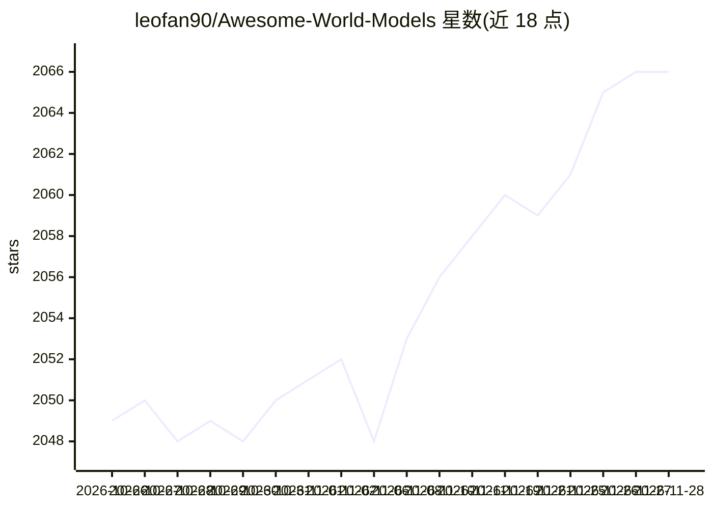

# leofan90/Awesome-World-Models

⭐ 2,066 · Python · BSD-3-Clause · 推送 2026-11-25 · [GitHub](https://github.com/leofan90/Awesome-World-Models) · 个人维护

**世界模型论文清单：覆盖视频生成、具身智能与自动驾驶**

策展型论文清单仓库，收录世界模型（World Models）方向的论文、代码与相关网站链接，按基础论文、博客/技术报告、综述等类别组织，覆盖通用视频生成、具身智能与自动驾驶三个方向。模板来自 Awesome-LLM-Robotics 与 Awesome-World-Model，维护者可使用 arXiv 候选流水线发现近期论文进行审阅，并欢迎通过 pull request 或邮件投稿补充条目。仓库本身不含可运行代码，仅提供文献索引。

## 筛选速览

| 维度 | 判定 | 备注 |
|---|---|---|
| AI 角色 | `ai-knowledge` | 知识聚合/清单类 |
| 许可风险 | `permissive` | BSD-3-Clause |
| 部署形态 | `None` |  |
| 模型依赖 | — | README 未给出锁定关系 |
| 硬件要求 | — | 无带数字的原话,不猜 |
| 安装摩擦 | `low` | 无编译、无系统依赖或容器化 |
| 成熟度 | — | 结构信号不足 |

## 能力要点

- 覆盖视频生成、具身智能、自动驾驶三个方向的世界模型文献
- 条目附论文、代码与网站链接
- 维护者使用 arXiv 候选流水线发现近期论文
- 接受社区 PR 与邮件投稿补充

## 适用场景

- 调研世界模型领域的研究进展
- 查找某篇世界模型论文的代码或项目主页
- 追踪具身智能与自动驾驶方向的综述文献

## 场景标签

`精选清单` · 领域:学习与行业

## 证据(README 行号)

> L3: This repository provides a curated list of **papers for World Models for General Video Generation, Embodied AI, and 
> L9: Maintainers can use the arXiv candidate pipeline to discover recent papers for review.
> L69: ## Survey

## 星数曲线

2026-10-26 2,049 → 2026-11-28 2,066（+17）

---
*卡片 v1 · prompt 1.4 · 生成 2026-11-26 · 置信度 high · 依据 README sha `fcddca96b1b0` · [字段定义](../../DATASET.md)*
