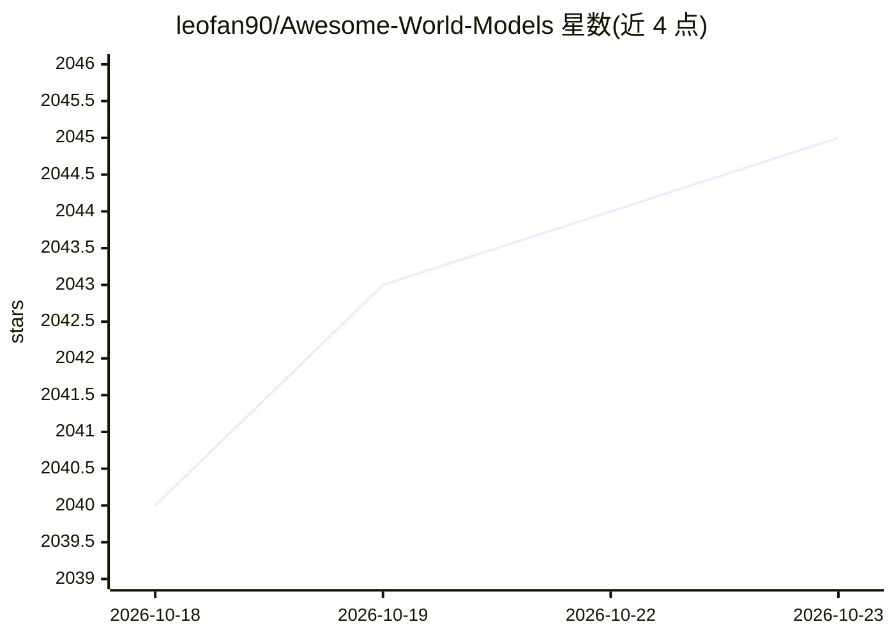

# leofan90/Awesome-World-Models

⭐ 2,045 · Python · BSD-3-Clause · 推送 2026-10-22 · [GitHub](https://github.com/leofan90/Awesome-World-Models) · 个人维护

**世界模型论文策展清单：视频生成/具身智能/自动驾驶方向**

由个人维护的 Awesome 类论文清单，收录 World Models 定义及在通用视频生成、具身智能、自动驾驶方向应用的论文、代码与网站链接。内容按基础论文、博客/技术报告、综述三类组织，条目附 Paper/Website/Code 链接；维护者可通过 arXiv 候选管道发现新论文供审阅，接受社区 PR 补充。模板来自 Awesome-LLM-Robotics 与 Awesome-World-Model。

## 筛选速览

| 维度 | 判定 | 备注 |
|---|---|---|
| AI 角色 | `ai-knowledge` | 知识聚合/清单类 |
| 许可风险 | `permissive` | BSD-3-Clause |
| 部署形态 | `None` |  |
| 模型依赖 | — | README 未给出锁定关系 |
| 硬件要求 | — | 无带数字的原话,不猜 |
| 安装摩擦 | `low` | 无编译、无系统依赖或容器化 |
| 成熟度 | — | 结构信号不足 |

## 能力要点

- 按基础论文/技术报告/综述三段组织的论文清单
- 条目附论文、代码与网站链接
- 提供 arXiv 候选管道供维护者发现新论文

## 适用场景

- 查找世界模型方向的综述与技术报告
- 追踪视频生成、具身智能与自动驾驶领域的世界模型研究
- 获取可复现代码的论文条目

## 场景标签

`精选清单` · 领域:学习与行业

## 证据(README 行号)

> L3: This repository provides a curated list of **papers for World Models for General Video Generation, Embodied AI, and 
> L68: ## Survey

## 星数曲线

2026-10-18 2,040 → 2026-10-23 2,045（+5）

---
*卡片 v1 · prompt 1.4 · 生成 2026-10-21 · 置信度 high · 依据 README sha `e2186619eedb` · [字段定义](../../DATASET.md)*
