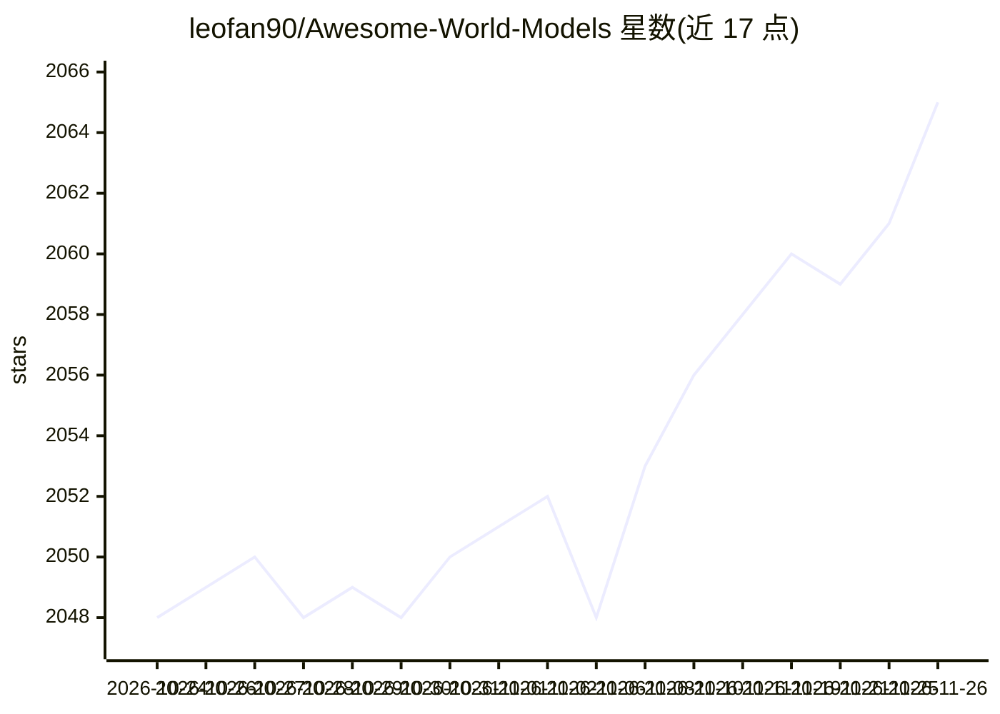

# leofan90/Awesome-World-Models

⭐ 2,065 · Python · BSD-3-Clause · 推送 2026-11-25 · [GitHub](https://github.com/leofan90/Awesome-World-Models) · 组织维护

**面向研究者的世界模型论文清单（视频生成/具身/自驾）**

收录世界模型相关论文的策展清单，覆盖通用视频生成、具身智能与自动驾驶三个方向，条目附论文、代码与相关网站链接；含奠基论文、博客/技术报告与综述三个板块，模板来自 Awesome-LLM-Robotics 与 Awesome-World-Model。维护者可使用 arXiv 候选流水线发现新论文，接受 PR 与邮件投稿，无安装或运行步骤。

## 筛选速览

| 维度 | 判定 | 备注 |
|---|---|---|
| AI 角色 | `ai-knowledge` | 知识聚合/清单类 |
| 许可风险 | `permissive` | BSD-3-Clause |
| 部署形态 | `None` |  |
| 模型依赖 | — | README 未给出锁定关系 |
| 硬件要求 | — | 无带数字的原话,不猜 |
| 安装摩擦 | `low` | 无编译、无系统依赖或容器化 |
| 成熟度 | — | 结构信号不足 |

## 能力要点

- 覆盖视频生成、具身智能、自动驾驶三大方向的世界模型论文
- 条目附论文、代码、网站链接
- 提供 arXiv 候选流水线辅助发现新论文

## 适用场景

- 进入世界模型研究领域时查找论文与代码入口
- 按方向浏览世界模型综述与技术报告
- 跟踪机器人操控、自驾仿真等方向的最新模型

## 场景标签

`精选清单` · 领域:学习与行业

## 证据(README 行号)

> L3: This repository provides a curated list of **papers for World Models for General Video Generation, Embodied AI, and 
> L9: Maintainers can use the arXiv candidate pipeline to discover recent papers for review.
> L15: ## Foundation paper of World Model

## 星数曲线

2026-10-24 2,048 → 2026-11-26 2,065（+17）

---
*卡片 v1 · prompt 1.4 · 生成 2026-11-23 · 置信度 high · 依据 README sha `c2d26980b2ab` · [字段定义](../../DATASET.md)*
