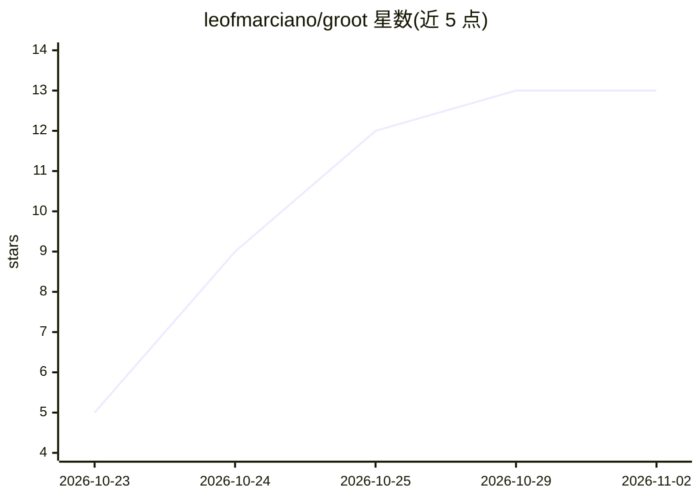

# leofmarciano/groot

⭐ 13 · Python · Apache-2.0 · 推送 2026-10-23 · [GitHub](https://github.com/leofmarciano/groot) · [官网](marcianotheory.com) · 个人维护

**开源类型化决策模型：长上下文上一次前向给出校准概率分布**

Groot 1 是基于 mmBERT 编码器（small/base 各一，分别 149M/482M 参数）的类型化决策模型：读取状态文本，对 choice/score/noul 三类 System One 格式问题输出完整概率分布，支持单次最多 255 个选项、状态至 64k token（BM25 检索 + tree-reduce 记忆）。训练数据为英文与葡萄牙语公开语料；README 记录了 v1.0 在葡萄牙语新闻上的失败与 v1.1 的修复过程，并给出与 Jev、Julia 1 的对比评测（A10G、BF16）。另提供与 PyTorch 数值一致（1e-7 内）的 Bend 前向实现。分类基准为域内监督结果，BoolQ 等知识/推理任务低于 Jev。

## 筛选速览

| 维度 | 判定 | 备注 |
|---|---|---|
| AI 角色 | `ai-native` | 本体是模型或模型工具 |
| 许可风险 | `permissive` | Apache-2.0 |
| 部署形态 | `library` | 以包/库形式分发 |
| 模型依赖 | — | README 未给出锁定关系 |
| 硬件要求 | — | 无带数字的原话,不猜 |
| 安装摩擦 | `low` | 无编译、无系统依赖或容器化 |
| 成熟度 | — | 结构信号不足 |

## 能力要点

- 一次前向输出 choice/score/noul 类型化决策的完整概率分布
- 长上下文至 64k token，选项顺序严格不变（block-masked attention）
- Groot 1 S 的纯 Bend 前向实现，与 PyTorch 偏差在 1e-7 内
- 附带置信度头与按类型拟合的温度校准

## 适用场景

- 工单路由、回复评分、轨迹标记等有限选项的产品决策
- 需要可校准概率而非生成式解码的分类判断
- 英/葡语长文档上的类型化问答与新闻分类

## 场景标签

 · 领域:NLP/决策模型

## 证据(README 行号)

> L22: Groot 1 is an open **typed-decision model**. It reads a state and answers typed questions about it with full probab
> L24: - **Groot 1** averages the probabilities of two members: an S model on mmBERT-small and an M model on mmBERT-base. 
> L168: Many product decisions are a finite choice: route a ticket, rate a reply, flag a trace, approve an invoice. A gene

## 星数曲线

2026-10-23 5 → 2026-11-02 13（+8）

---
*卡片 v1 · prompt 1.4 · 生成 2026-10-31 · 置信度 high · 依据 README sha `2748c6a92d2e` · [字段定义](../../DATASET.md)*
