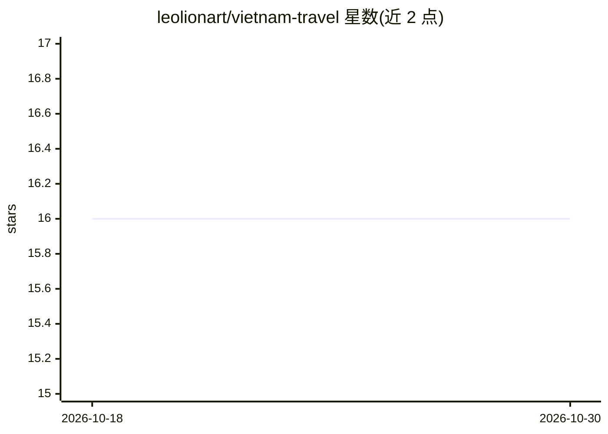

# leolionart/vietnam-travel

⭐ 16 · HTML · 推送 2026-07-07 · [GitHub](https://github.com/leolionart/vietnam-travel) · [官网](https://leolionart.github.io/vietnam-travel/) · 个人维护

**让 AI 通过 MCP 生成并可视化越南自驾行程的分享工具**

面向越南自驾旅行场景的 MCP 服务器与 Web 展示应用：用户将自己的 AI 客户端（Claude Desktop/Code、Cursor、Windsurf、Gemini CLI、Codex CLI、Zed、Continue 等）连接到该 MCP 端点后，AI 可调用 create_plan、add_location、add_sub_location 等 13 个工具生成行程，输出带时间线、地图、活动明细与费用汇总的可分享链接，无需登录即可分享与协作修改。支持带管理员口令的生产模式编辑与无口令的会话模式。提供 JSON-first CLI 供 Codex 等自动化使用，支持 git clone 源码与 Docker Compose 自托管，数据存于各环境独立的 SQLite。

## 筛选速览

| 维度 | 判定 | 备注 |
|---|---|---|
| AI 角色 | `ai-ecosystem` | LLM/agent 周边工具 |
| 许可风险 | `none` | — |
| 部署形态 | `self-host` | docker 或自建部署 |
| 模型依赖 | locked-api |  |
| 硬件要求 | — | 无带数字的原话,不猜 |
| 安装摩擦 | `low` | 无编译、无系统依赖或容器化 |
| 成熟度 | — | 结构信号不足 |

## 能力要点

- MCP 端点提供 13 个行程增删改查工具，支持 8 种 AI 客户端接入
- 生成带地图、时间线、活动明细与费用汇总的可分享链接，无需登录
- 会话隔离与管理员口令两种编辑模式，prod/local 各自独立 SQLite
- 支持 Docker Compose 自托管与本地 stdio MCP，附 JSON-first CLI

## 适用场景

- 让 Claude/Cursor 等 AI 客户端直接生成可视化越南自驾行程并分享给同行好友
- 跨多次对话继续编辑已有行程（通过 share link 作为编辑句柄）
- 自托管实例并用 CLI 自动化批量管理行程数据

## 场景标签

 · 领域:旅行工具/AI 集成

## 证据(README 行号)

> L13: ## Quick start — Add the MCP to your AI
> L15: No installation needed. Connect your AI directly to the server:
> L167: |Tool|What it does|

## 星数曲线

2026-10-18 16 → 2026-10-30 16（+0）

---
*卡片 v1 · prompt 1.4 · 生成 2026-10-30 · 置信度 mid · 依据 README sha `5c8ad6d9ed20` · [字段定义](../../DATASET.md)*
