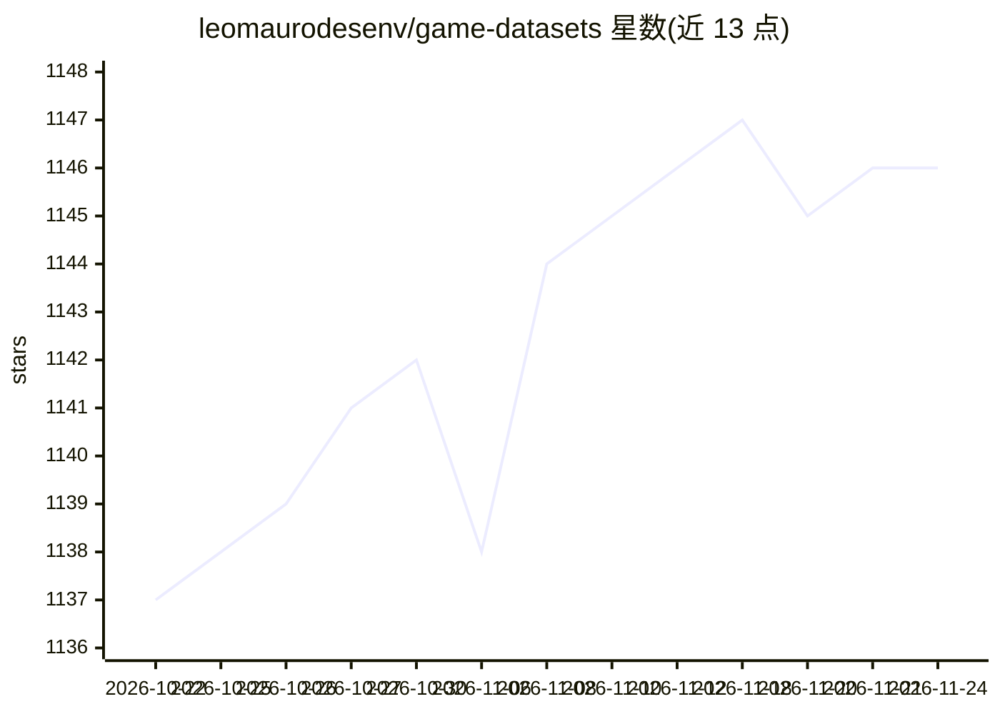

# leomaurodesenv/game-datasets

⭐ 1,146 · CC-BY-4.0 · 推送 2026-10-25 · [GitHub](https://github.com/leomaurodesenv/game-datasets) · 个人维护

**游戏 AI 与数据挖掘的数据集/工具策展清单**

面向在数字游戏中开展人工智能与数据挖掘工作的使用者，按 API、AI 平台与竞赛环境、书籍、数据集等板块组织资源链接，覆盖 Dota 2、StarCraft、宝可梦、桌游、Steam 评论等多类游戏数据来源，以及 Malmo、microRTS、Robocode 等实验平台。仓库以清单形式持续更新，通过 issue 与 pull request 接收贡献，采用 CC-BY-4.0 许可，由 GitHub Actions 维护工作流。

## 筛选速览

| 维度 | 判定 | 备注 |
|---|---|---|
| AI 角色 | `ai-knowledge` | 知识聚合/清单类 |
| 许可风险 | `viral` | CC-BY-4.0 |
| 部署形态 | `None` |  |
| 模型依赖 | — | README 未给出锁定关系 |
| 硬件要求 | — | 无带数字的原话,不猜 |
| 安装摩擦 | `low` | 无编译、无系统依赖或容器化 |
| 成熟度 | — | 结构信号不足 |

## 能力要点

- 收录 30+ 游戏数据 API 入口
- 整理 80+ 游戏数据集条目
- 列出 Malmo、microRTS、Robocode 等 AI 实验/竞赛平台
- 配套游戏 AI 与数据挖掘相关书籍文献

## 适用场景

- 为游戏 AI 研究找现成对局/玩家数据集
- 查找某款游戏的数据 API 接口
- 为数据挖掘课程或项目挑选游戏数据来源

## 场景标签

`精选清单` · 领域:学习与行业

## 证据(README 行号)

> L11: This repository guides work with **Artificial Intelligence** or **Data Mining** in digital games. Find datasets, to
> L112: ## Dataset
> L19: （目录 11 行略）

## 星数曲线

2026-10-22 1,137 → 2026-11-24 1,146（+9）

---
*卡片 v1 · prompt 1.4 · 生成 2026-11-24 · 置信度 high · 依据 README sha `fc4074a44ffb` · [字段定义](../../DATASET.md)*
