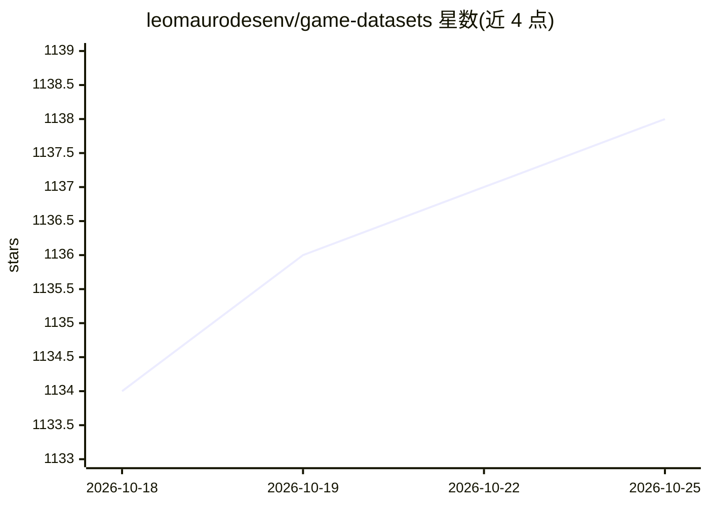

# leomaurodesenv/game-datasets

⭐ 1,138 · CC-BY-4.0 · 推送 2026-10-17 · [GitHub](https://github.com/leomaurodesenv/game-datasets) · 个人维护

**游戏领域 AI 与数据挖掘的数据集/工具/资料策展清单**

面向游戏方向研究与开发的 awesome 类清单：汇集游戏相关 API（Steam、Riot、PokéAPI 等 20 余个）、AI 研究平台与竞赛（Malmo、StarCraft AI、Vindinium 等）、数据挖掘与 AI 书目，以及上百个游戏数据集（英雄联盟、Dota 2、宝可梦、Steam 评论等）。条目按 API、Artificial Intelligence、Books、Dataset 等分类组织，供用户构建游戏应用或数据集时查找素材。仓库以 CC-BY-4.0 许可，通过 issue 和 pull request 接受贡献。

## 筛选速览

| 维度 | 判定 | 备注 |
|---|---|---|
| AI 角色 | `ai-knowledge` | 知识聚合/清单类 |
| 许可风险 | `viral` | CC-BY-4.0 |
| 部署形态 | `None` |  |
| 模型依赖 | — | README 未给出锁定关系 |
| 硬件要求 | — | 无带数字的原话,不猜 |
| 安装摩擦 | `low` | 无编译、无系统依赖或容器化 |
| 成熟度 | — | 结构信号不足 |

## 能力要点

- 20+ 个游戏数据 API 条目（Steam/Riot/OpenDota 等）
- AI 研究平台与游戏 AI 竞赛条目（Malmo、StarCraft AI 等）
- 上百个游戏数据集覆盖 LoL、Dota 2、宝可梦、Steam 等
- 含 8 本游戏分析与 AI 相关书目

## 适用场景

- 为游戏数据挖掘项目查找现成数据集
- 寻找游戏 AI 研究平台与竞赛环境
- 通过 API 获取游戏与玩家数据构建应用

## 场景标签

`精选清单` · 领域:学习与行业

## 证据(README 行号)

> L11: This repository guides work with **Artificial Intelligence** or **Data Mining** in digital games. Find datasets, to
> L112: ## Dataset

## 星数曲线

2026-10-18 1,134 → 2026-10-25 1,138（+4）

---
*卡片 v1 · prompt 1.4 · 生成 2026-10-21 · 置信度 high · 依据 README sha `df6c335021b0` · [字段定义](../../DATASET.md)*
