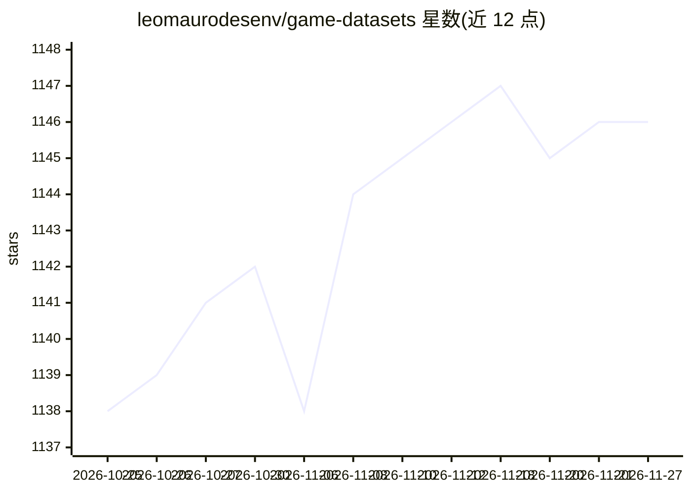

# leomaurodesenv/game-datasets

⭐ 1,146 · CC-BY-4.0 · 推送 2026-11-26 · [GitHub](https://github.com/leomaurodesenv/game-datasets) · 个人维护

**游戏 AI 与数据挖掘的数据集策展清单**

一个 awesome 类策展仓库，收录与数字游戏相关的数据集、API、工具与研究资料：数据集条目覆盖电竞比赛记录、玩家行为、卡牌、评测评论等；另列出游戏数据 API、可用于 AI 实验的游戏平台与竞赛环境、相关书籍。以链接列表形式组织，接受 issue 与 pull request 贡献。仓库本身不包含模型或代码实现，使用时需自行访问各条目链接获取数据。

## 筛选速览

| 维度 | 判定 | 备注 |
|---|---|---|
| AI 角色 | `ai-knowledge` | 知识聚合/清单类 |
| 许可风险 | `viral` | CC-BY-4.0 |
| 部署形态 | `None` |  |
| 模型依赖 | — | README 未给出锁定关系 |
| 硬件要求 | — | 无带数字的原话,不猜 |
| 安装摩擦 | `low` | 无编译、无系统依赖或容器化 |
| 成熟度 | — | 结构信号不足 |

## 能力要点

- 收录约 80 个游戏相关数据集条目（LoL、CS:GO、StarCraft、宝可梦等）
- 整理 20+ 游戏数据 API（Steam、Riot Games、OpenDota 等）
- 列出可用于 AI 研究的游戏平台与竞赛环境（Malmo、Halite、Retro Contest 等）
- 附数据挖掘与游戏 AI 相关书目

## 适用场景

- 为游戏 AI 研究寻找公开对局与玩家行为数据集
- 查找游戏数据 API 以抓取比赛或评论数据
- 选取游戏环境开展强化学习实验

## 场景标签

`精选清单` · 领域:学习与行业

## 证据(README 行号)

> L11: This repository guides work with **Artificial Intelligence** or **Data Mining** in digital games. Find datasets, to
> L111: ## Dataset

## 星数曲线

2026-10-25 1,138 → 2026-11-27 1,146（+8）

---
*卡片 v1 · prompt 1.4 · 生成 2026-11-27 · 置信度 high · 依据 README sha `4c4f7282f2c5` · [字段定义](../../DATASET.md)*
