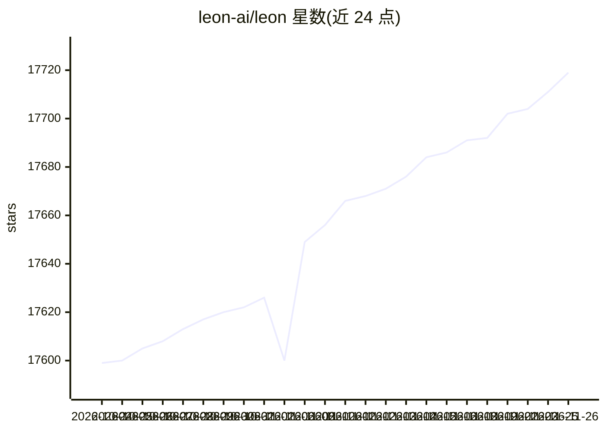

# leon-ai/leon

⭐ 17,719 · TypeScript · MIT · 推送 2026-11-25 · [GitHub](https://github.com/leon-ai/leon) · [官网](https://getleon.ai) · 个人维护 · 中文 README

**开源个人 AI 助手，本地运行并提供 Web 应用**

由 Louis Grenard 自 2017 年起开发的开源个人 AI 助手，目标是在用户日常生活中记住重要事项并代为完成事务。当前处于 2.0 alpha 开发阶段，提供 Web 应用预览与计划的桌面应用。核心机制包括持续 agent 循环、隔离 worker 中的工具执行、渐进式上下文管理、多层记忆（临时上下文、持久偏好、每日摘要等按 profile 隔离）、原生技能与 agent 技能双体系。支持本地与远程模型，可在自己的机器上运行。Node.js >= 24，从源码安装，下载在中国机器上使用国内镜像。旧版文档与 2.0 实际状态存在差异。

## 筛选速览

| 维度 | 判定 | 备注 |
|---|---|---|
| AI 角色 | `ai-native` | 本体是模型或模型工具 |
| 许可风险 | `permissive` | MIT |
| 部署形态 | `library` | 以包/库形式分发 |
| 模型依赖 | — | README 未给出锁定关系 |
| 硬件要求 | — | 无带数字的原话,不猜 |
| 安装摩擦 | `low` | 无编译、无系统依赖或容器化 |
| 成熟度 | `idea` | |

## 动量与使用信号

- 维护:`active` — 距上次 push 5.8 天,年发版 3,23 位贡献者
- 涨星:近 1 天 **+4**(自 20261016 起算)
- 平台:WINDOWS / MACOS / LINUX · 协议:—

## 能力要点

- 持续 agent 循环与隔离 worker 中的并发工具执行
- 多层记忆：持久事实/偏好、每日摘要、讨论记忆按 profile 隔离
- 原生技能与 agent 技能共用同一工具系统
- 支持本地与远程模型，可自托管运行

## 适用场景

- 本地自托管一个记住个人偏好与事项的 AI 助手
- 让助手连接 Spotify 等自有工具并执行任务
- 在对话中获得图表、表单等生成式 UI 回答

## 场景标签

`AI 助手` · 领域:对话与助手

## 证据(README 行号)

> L6:  Your open-source personal AI assistant.
> L93: A good model matters. So does everything around it. Leon has its own continuous agent loop, tool execution in isola
> L122: - **Personal AI should belong to you.** An assistant that knows you well will hold things that matter to you. That

## 星数曲线

2026-10-24 17,599 → 2026-11-26 17,719（+120）

---
*卡片 v1 · prompt 1.4 · 生成 2026-11-22 · 置信度 high · 依据 README sha `039c9a842c3d` · [字段定义](../../DATASET.md)*
