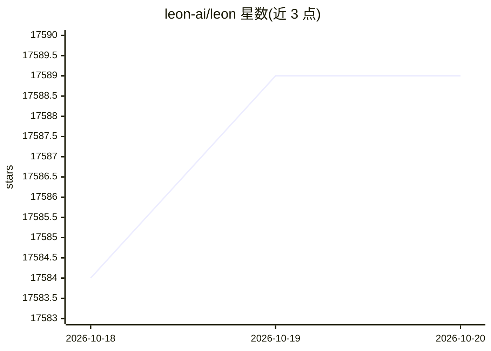

# leon-ai/leon

⭐ 17,589 · TypeScript · MIT · 推送 2026-10-19 · [GitHub](https://github.com/leon-ai/leon) · [官网](https://getleon.ai) · 个人维护

**开源个人 AI 助手：以工具、上下文、记忆与 agent 执行完成任务**

Leon 是一个开源个人 AI 助手，围绕工具、上下文、记忆与 agentic 执行构建。三种运行模式：smart 自动选择、controlled 走确定性原生技能、agent 逐步规划；技能分 native 与 SKILL.md 格式的 agent 两类，并含可操作桌面与浏览器界面的 computer use 能力。支持本地与远程 AI 提供商以平衡隐私。需 Node.js >= 24，克隆仓库后 pnpm 运行，默认本地 http://localhost:5366 访问。当前为 2.0 Developer Preview，新文档尚未就绪。

## 筛选速览

| 维度 | 判定 | 备注 |
|---|---|---|
| AI 角色 | `ai-native` | 本体是模型或模型工具 |
| 许可风险 | `permissive` | MIT |
| 部署形态 | `None` |  |
| 模型依赖 | — | README 未给出锁定关系 |
| 硬件要求 | — | 无带数字的原话,不猜 |
| 安装摩擦 | `low` | 无编译、无系统依赖或容器化 |
| 成熟度 | `idea` | |

## 动量与使用信号

- 维护:`active` — 距上次 push 5.8 天,年发版 3,23 位贡献者
- 涨星:近 1 天 **+4**(自 20261016 起算)
- 平台:WINDOWS / MACOS / LINUX · 协议:—

## 能力要点

- smart/controlled/agent 三种执行模式
- 原生技能与 SKILL.md agent 技能双层体系
- 渐进加载的 computer use 可操作桌面与浏览器界面
- 支持本地与远程 AI 提供商

## 适用场景

- 本地运行个人助手以减少数据经第三方服务
- 让助手用工具端到端完成确定性工作流
- 用 agent 模式逐步规划复杂任务

## 场景标签

`AI 助手` `GUI 自动化` · 领域:效率与自动化

## 证据(README 行号)

> L31: **Leon** is **your open-source personal AI assistant** built around **tools, context, memory, and agentic execution
> L41: - Leon can run in different ways depending on the task: `smart` mode chooses for you, `controlled` mode follows det
> L47: - Leon supports both local and remote AI providers, which helps balance privacy, control, and capability.

## 星数曲线

2026-10-18 17,584 → 2026-10-20 17,589（+5）

---
*卡片 v1 · prompt 1.4 · 生成 2026-10-18 · 置信度 high · 依据 README sha `153f4fad2373` · [字段定义](../../DATASET.md)*
