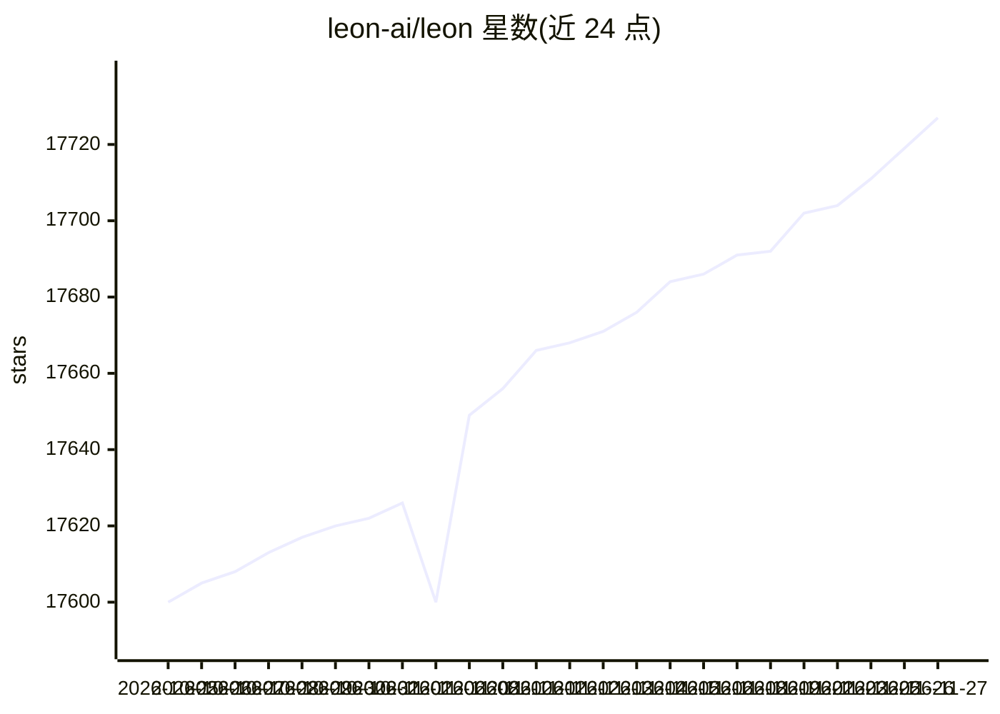

# leon-ai/leon

⭐ 17,727 · TypeScript · MIT · 推送 2026-11-26 · [GitHub](https://github.com/leon-ai/leon) · [官网](https://getleon.ai) · 个人维护 · 中文 README

**开源个人 AI 助手：记忆、工具执行与日常事务自动化**

Node.js 构建的开源个人 AI 助手，自 2019 年发布首个开源版本，当前正重写为 2.0（桌面应用未发布，develop 分支开发中）。核心机制包括持续的 agent 循环、隔离 worker 中的工具执行、渐进式上下文管理与多层记忆（临时上下文、持久偏好、每日摘要，按配置档隔离）；提供生成式 UI（图表/表单回答）、任务规划与执行、连接第三方工具（如 Spotify）等。支持本地与远程模型，可运行于用户自己的机器。

## 筛选速览

| 维度 | 判定 | 备注 |
|---|---|---|
| AI 角色 | `ai-native` | 本体是模型或模型工具 |
| 许可风险 | `permissive` | MIT |
| 部署形态 | `library` | 以包/库形式分发 |
| 模型依赖 | — | README 未给出锁定关系 |
| 硬件要求 | — | 无带数字的原话,不猜 |
| 安装摩擦 | `low` | 无编译、无系统依赖或容器化 |
| 成熟度 | `idea` | |

## 动量与使用信号

- 维护:`active` — 距上次 push 5.8 天,年发版 3,23 位贡献者
- 涨星:近 1 天 **+4**(自 20261016 起算)
- 平台:WINDOWS / MACOS / LINUX · 协议:—

## 能力要点

- 自带 agent 循环：工具结果驱动决策，独立工具调用可并发运行于隔离 worker
- 多层记忆：临时上下文、持久事实偏好、每日摘要按配置档隔离并可检索
- 提供 native skills（显式动作）与 agent skills（灵活任务）两类技能体系
- 支持本地与远程模型，可自托管运行

## 适用场景

- 自托管一个了解自己偏好与习惯的个人助手
- 通过自然语言让 AI 规划并执行日常任务
- 用生成式 UI 在对话中获得图表与可视化回答

## 场景标签

`AI 助手` `聊天机器人` · 领域:对话与助手

## 证据(README 行号)

> L6:  Your open-source personal AI assistant.
> L93: A good model matters. So does everything around it. Leon has its own continuous agent loop, tool execution in isola

## 星数曲线

2026-10-25 17,600 → 2026-11-27 17,727（+127）

---
*卡片 v1 · prompt 1.4 · 生成 2026-11-27 · 置信度 high · 依据 README sha `8a9e54e4a95b` · [字段定义](../../DATASET.md)*
