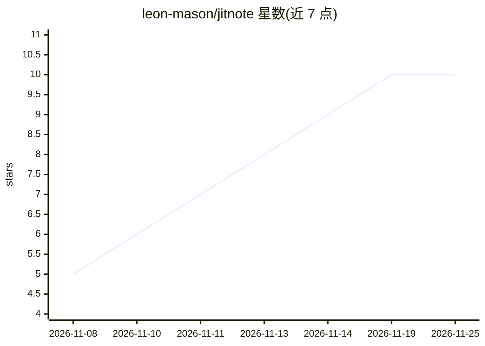

# leon-mason/jitnote

⭐ 10 · Swift · Apache-2.0 · 推送 2026-11-09 · [GitHub](https://github.com/leon-mason/jitnote) · 个人维护 · 中文 README

**把笔记存到自己 GitHub/Gitee 仓库的多端 Markdown 笔记应用**

无服务器的本地优先笔记应用：每个笔记本是用户自己账号下的真实 Git 仓库，手机与桌面端通过提交→拉取→合并→推送的同步流程维护版本，冲突时人工选择保留哪一版，未选中版本留在历史中。笔记为标准 Markdown，Obsidian/Typora 仓库可直接接入；由于是普通 Git 仓库，Claude Code、Cursor 等外部 AI 工具可对笔记文件做整理与改写，改后同步即可。提供 Android 8.0+、Apple 芯片 Mac 与 Windows 11 安装包。

## 筛选速览

| 维度 | 判定 | 备注 |
|---|---|---|
| AI 角色 | `ai-enhanced` | 去掉 AI 部分产品仍成立 |
| 许可风险 | `permissive` | Apache-2.0 |
| 部署形态 | `desktop` | 安装包/桌面程序 |
| 模型依赖 | — | README 未给出锁定关系 |
| 硬件要求 | — | 无带数字的原话,不猜 |
| 安装摩擦 | `medium` | 含编译或系统依赖之一 |
| 成熟度 | `idea` | |

## 能力要点

- 笔记本即真实 Git 仓库，含完整 .git 与提交历史
- 无需任何服务器，账号令牌与内容不经过第三方
- 同步冲突人工裁决，数据不丢、从不强推
- 兼容 Obsidian/Typora 既有仓库，文件与图片写法保留

## 适用场景

- 在手机和电脑间用 Git 同步管理 Markdown 笔记
- 复用已有的 Obsidian 仓库并保持可编辑性
- 让 Claude Code/Cursor 等 AI 工具整理、改写、查询自己的笔记
- 对数据存放位置有主权要求的个人笔记场景

## 场景标签

`知识库管理` · 领域:知识与检索

## 证据(README 行号)

> L5: 「记特」读作 Git：把笔记放进**你自己的** GitHub / Gitee 私有仓库，手机（Android）、Mac 和 Windows 11 上都能写。
> L9: - **AI 协同维护和查询**：笔记是普通的 Markdown 文件、真正的 Git 仓库。Claude Code、Cursor 等 AI 工具可以直接帮你整理、改写、查询，改完推上去，手机点一下同步就能看到。

## 星数曲线

2026-11-08 5 → 2026-11-25 10（+5）

---
*卡片 v1 · prompt 1.4 · 生成 2026-11-19 · 置信度 mid · 依据 README sha `7bdb0be9b992` · [字段定义](../../DATASET.md)*
