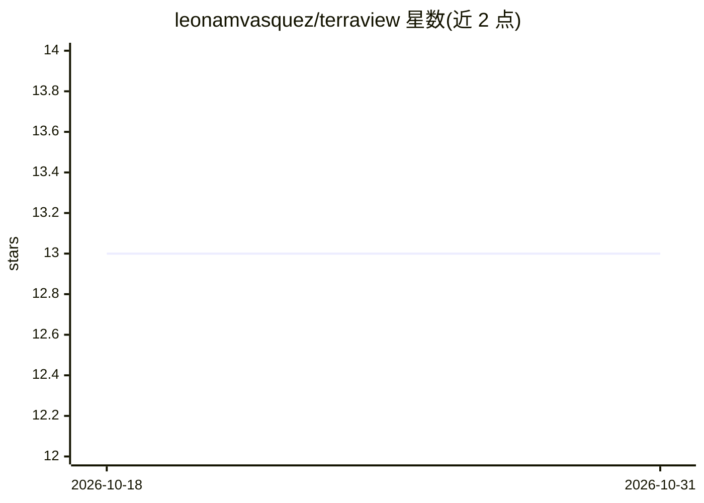

# leonamvasquez/terraview

⭐ 13 · Go · MIT · 推送 2026-09-14 · [GitHub](https://github.com/leonamvasquez/terraview) · [官网](https://leonamvasquez.github.io/terraview/) · 个人维护 · 中文 README

**给 IaC 工程师：Terraform plan 的安全与合规扫描工具，含 AI 上下文分析**

Go 编写的单二进制 Terraform plan 安全分析工具：自动集成 Checkov/Trivy/Terrascan 静态扫描（含 43 条内嵌 CKV_AWS 规则的 builtin scanner 作为无外部依赖回退），当配置 AI provider 后并行执行上下文分析（跨资源关系、依赖链、架构反模式）。AI provider 支持 Ollama（本地）、Gemini、Claude、OpenAI、DeepSeek、OpenRouter 及任意 OpenAI 兼容 API、Gemini CLI/Claude Code 签名方式。另提供 AI 修复建议（fix plan/apply，带风险分类器）、统一评分（0-10）、SQLite 扫描历史、SARIF/JSON/Markdown 输出与 MCP Server。未配置 provider 时仅运行静态扫描。安装支持 install.sh、brew、scoop、apt、dnf、Docker 与源码编译；运行需 Terraform >= 0.12。

## 筛选速览

| 维度 | 判定 | 备注 |
|---|---|---|
| AI 角色 | `ai-enhanced` | 去掉 AI 部分产品仍成立 |
| 许可风险 | `permissive` | MIT |
| 部署形态 | `self-host` | docker 或自建部署 |
| 模型依赖 | local-ok | 支持本地模型 |
| 硬件要求 | — | 无带数字的原话,不猜 |
| 安装摩擦 | `low` | 无编译、无系统依赖或容器化 |
| 成熟度 | — | 结构信号不足 |

## 能力要点

- Checkov/Trivy/Terrascan 自动集成 + 43 条内嵌 CKV_AWS 规则的无依赖 builtin scanner
- AI 与静态扫描并行执行，scanner 优先于 AI 解决分歧（confidence 0.80）
- AI Fix：为 CRITICAL/HIGH findings 生成并应用 HCL 修复，带多信号风险分类器
- MCP Server 暴露 blast radius 分析给 AI agent（Claude Code/Cursor/Windsurf）

## 适用场景

- 在 terraform apply 前检测安全与合规 misconfiguration
- 在 CI/CD（GitHub Actions/GitLab CI/Azure DevOps）中输出 SARIF 并按 exit code 拦截
- 用本地 Ollama 做离线 AI 上下文分析或自动修复建议
- 通过 MCP 让 AI agent 查询基础设施变更的影响范围

## 场景标签

`网络安全` · 领域:学习与行业

## 证据(README 行号)

> L14: O Terraview é uma ferramenta Open Source de análise de segurança para planos Terraform que combina scanners estátic
> L18: O Terraview roda como binário único, sem dependências externas. Quando um provider de IA está configurado, scanner 
> L102: terraview scan checkov --static             # somente scanner, sem IA

## 星数曲线

2026-10-18 13 → 2026-10-31 13（+0）

---
*卡片 v1 · prompt 1.4 · 生成 2026-10-31 · 置信度 mid · 依据 README sha `25e86f35b193` · [字段定义](../../DATASET.md)*
