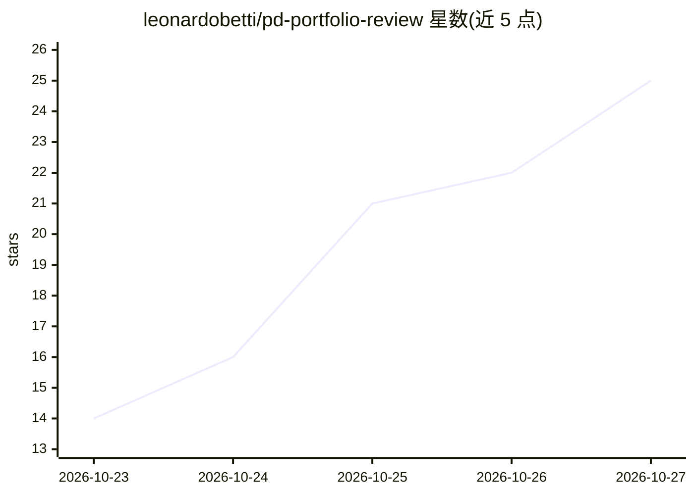

# leonardobetti/pd-portfolio-review

⭐ 25 · TypeScript · MIT · 推送 2026-10-22 · [GitHub](https://github.com/leonardobetti/pd-portfolio-review) · [官网](https://pd-portfolio-review.vercel.app/) · 个人维护

**AI agent 技能：以招聘评审视角给设计作品集打分出报告**

可安装的 agent 技能（SKILL.md 格式），配合 Claude Code、Cursor、Codex 等使用：输入作品集 URL 后，模拟招聘评审浏览首页、作品列表、案例研究等页面，输出百分制评分报告，含优势、问题、红旗检查、开放检查项与最多五条按优先级排序的修复建议（各附验收标准）。评分权重参考 UXfolio 2026 报告章节，每条发现标注 Rendered/Source/Unverified 证据等级。仓库同时包含 Next.js 营销落地页，附 27 个评测用例。安装需 Node.js 22+，MIT 许可。

## 筛选速览

| 维度 | 判定 | 备注 |
|---|---|---|
| AI 角色 | `ai-native` | 本体是模型或模型工具 |
| 许可风险 | `permissive` | MIT |
| 部署形态 | `library` | 以包/库形式分发 |
| 模型依赖 | — | README 未给出锁定关系 |
| 硬件要求 | — | 无带数字的原话,不猜 |
| 安装摩擦 | `low` | 无编译、无系统依赖或容器化 |
| 成熟度 | — | 结构信号不足 |

## 能力要点

- 百分制评分报告：优势、红旗检查、最多五条优先级排序的修复建议
- 每条发现标注 Rendered/Source/Unverified 三级证据标签
- 内置公平性规则（不以视觉精致度推断资历等）与 27 个评测用例
- 支持 Claude Code / Cursor / Codex 的安装与调用路径

## 适用场景

- 求职前用 AI 模拟招聘评审视角检查自己的设计作品集
- 定位作品集的红旗问题并按优先级获得可验收的修复清单
- 给 UX/UI 作品集打分并得到是否可投递的分级判定

## 场景标签

 · 领域:设计求职工具/agent 技能

## 证据(README 行号)

> L3: An AI skill that reviews product designer portfolios (and UX / UI portfolios) the way a busy hiring reviewer would. 
> L20: 3. You get a scored report: strengths, problems, a red-flag check, open checks, questions only you can answer, and 
> L71: npx skills add leonardobetti/pd-portfolio-review@pd-portfolio-review

## 星数曲线

2026-10-23 14 → 2026-10-27 25（+11）

---
*卡片 v1 · prompt 1.4 · 生成 2026-10-27 · 置信度 high · 依据 README sha `70bca458f06c` · [字段定义](../../DATASET.md)*
