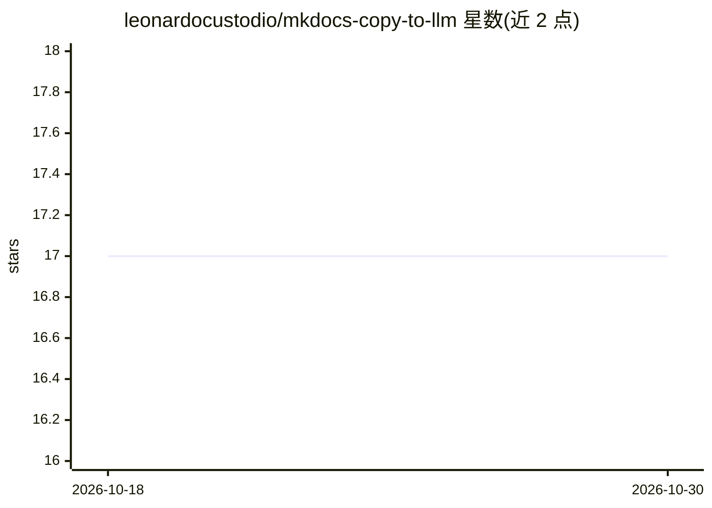

# leonardocustodio/mkdocs-copy-to-llm

⭐ 17 · Python · MIT · 推送 2026-07-06 · [GitHub](https://github.com/leonardocustodio/mkdocs-copy-to-llm) · [官网](https://leonardocustodio.github.io/mkdocs-copy-to-llm/) · 个人维护

**MkDocs 插件：为文档页与代码块添加面向 LLM 优化的复制按钮**

一个 MkDocs 插件，向文档页面注入 JavaScript 与 CSS，在页面标题处添加分栏按钮，支持以 Markdown 格式复制整页内容、复制 Markdown 链接、在 ChatGPT 或 Claude 中打开、查看原始 Markdown，并对代码块提供复制功能，内容自动按 LLM 消费场景格式化。可自定义按钮与提示颜色、配置仓库原始内容 URL、可选启用资产压缩与复制事件分析（默认关闭、需显式开启并已配置分析平台）。通过 pip 安装，MIT 许可。

## 筛选速览

| 维度 | 判定 | 备注 |
|---|---|---|
| AI 角色 | `ai-ecosystem` | LLM/agent 周边工具 |
| 许可风险 | `permissive` | MIT |
| 部署形态 | `library` | 以包/库形式分发 |
| 模型依赖 | — | README 未给出锁定关系 |
| 硬件要求 | — | 无带数字的原话,不猜 |
| 安装摩擦 | `medium` | 含编译或系统依赖之一 |
| 成熟度 | — | 结构信号不足 |

## 能力要点

- 整页复制为 Markdown、在 ChatGPT/Claude 中打开、查看原始 Markdown
- 内容按 LLM 消费自动格式化并提供上下文
- 按钮/提示颜色可定制，支持 CSS 变量
- 可选资产压缩与复制事件分析（默认关闭，需显式开启）

## 适用场景

- 文档站访客一键复制页面内容粘贴给 LLM 使用
- 把文档页面快速发送到 ChatGPT 或 Claude 对话
- 跟踪用户对文档复制行为的使用情况

## 场景标签

 · 领域:文档工具/LLM 辅助

## 证据(README 行号)

> L9: A MkDocs plugin that adds "Copy to LLM" buttons to your documentation, making it easy to copy code blocks and entire
> L21: - **Smart formatting** — Automatically formats content with proper context for LLM consumption

## 星数曲线

2026-10-18 17 → 2026-10-30 17（+0）

---
*卡片 v1 · prompt 1.4 · 生成 2026-10-29 · 置信度 high · 依据 README sha `9d3ee3aeb72c` · [字段定义](../../DATASET.md)*
