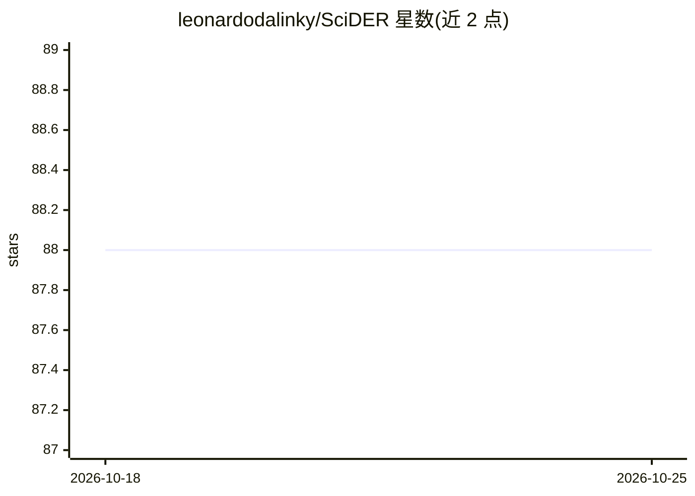

# leonardodalinky/SciDER

⭐ 88 · Python · Apache-2.0 · 推送 2026-10-12 · [GitHub](https://github.com/leonardodalinky/SciDER) · [官网](https://leonardodalinky.github.io/scider-proj-page/) · 组织维护

**面向科研的端到端 AI 研究员：从想法到数据分析、实验与成稿论文**

数据为中心的科研 agent 系统，提供 7 种工作流：文献驱动的选题（IdeationWorkflow）、数据集分析与结构化摘要、合成数据生成、实验实现与执行、论文写作，以及可按阶段跳过的完整流水线。论文写作支持 7 种会议/期刊模板（NeurIPS、ACL、ICML、ICLR、AAAI、IEEE、ACM），样式文件首次使用时自动下载。通过统一模型目录按 agent 角色混用不同提供商模型（LiteLLM id），实验编码可委托 Claude Agent SDK 或内置原生编码 agent。提供 Streamlit Web UI（含 token/费用追踪、暂停取消）、Docker 部署与 SKILL.md 格式的技能注入机制。需提供 API key（Anthropic/Gemini/OpenAI 等）。

## 筛选速览

| 维度 | 判定 | 备注 |
|---|---|---|
| AI 角色 | `ai-native` | 本体是模型或模型工具 |
| 许可风险 | `permissive` | Apache-2.0 |
| 部署形态 | `self-host` | docker 或自建部署 |
| 模型依赖 | locked-api |  |
| 硬件要求 | — | 无带数字的原话,不猜 |
| 安装摩擦 | `low` | 无编译、无系统依赖或容器化 |
| 成熟度 | — | 结构信号不足 |

## 能力要点

- 7 种工作流覆盖选题→数据分析→实验→论文写作全链路
- 生成 7 种会议模板的 LaTeX/PDF 论文（NeurIPS/ACL/ICML/ICLR/AAAI/IEEE/ACM）
- 统一模型目录按 agent 角色混用不同提供商模型
- Claude Agent SDK 与内置原生编码两种实验后端可选
- SKILL.md 技能注入与 Streamlit Web UI（费用追踪、暂停取消）

## 适用场景

- 从文献检索生成研究想法并执行完整研究流程
- 对数据集做结构化分析并自动产出会议格式论文
- 按 agent 角色混用不同提供商的模型跑科研工作流

## 场景标签

`科研工具` `数据分析` · 领域:效率与自动化

## 证据(README 行号)

> L38: SciDER provides seven workflows in `scider.workflows`:
> L47: |`FullWorkflow`|Data analysis -> experiment execution -> (optional) paper writing.|
> L62: SciDER uses a **unified model catalog** so you can mix providers per agent role. `model_settings/catalog.yaml` is t

## 星数曲线

2026-10-18 88 → 2026-10-25 88（+0）

---
*卡片 v1 · prompt 1.4 · 生成 2026-10-23 · 置信度 high · 依据 README sha `05438e055234` · [字段定义](../../DATASET.md)*
