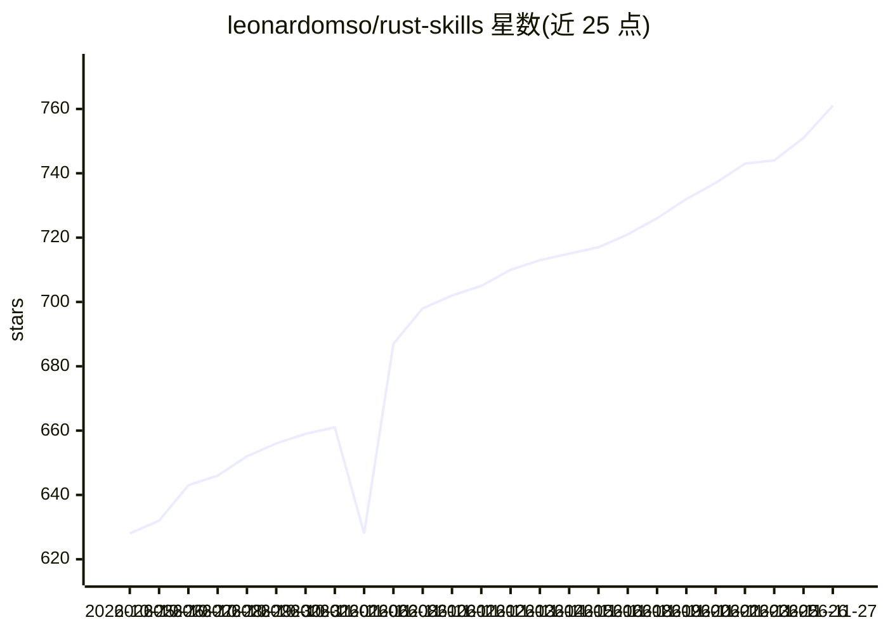

# leonardomso/rust-skills

⭐ 761 · Python · MIT · 推送 2026-11-26 · [GitHub](https://github.com/leonardomso/rust-skills) · 个人维护

**给 AI 编码代理提供 268 条 Rust 规范规则的技能库**

将 268 条 Rust 编写规则组织为 26 个类别（所有权借用、错误处理、异步、unsafe、API 设计等），以 agent skills 格式供 AI 编码代理按需加载。SKILL.md 作轻量索引进度式披露，agent 只读取与当前代码相关的一小部分规则文件以控制 token 消耗。安装通过 skills CLI 或针对各 agent 的手动 git clone/curl 完成；示例代码在 CI 中按固定工具链做编译检查。规则为原创综述，注明来源出处，MIT 许可。

## 筛选速览

| 维度 | 判定 | 备注 |
|---|---|---|
| AI 角色 | `ai-knowledge` | 知识聚合/清单类 |
| 许可风险 | `permissive` | MIT |
| 部署形态 | `library` | 以包/库形式分发 |
| 模型依赖 | — | README 未给出锁定关系 |
| 硬件要求 | — | 无带数字的原话,不猜 |
| 安装摩擦 | `low` | 无编译、无系统依赖或容器化 |
| 成熟度 | — | 结构信号不足 |

## 能力要点

- 268 条规则分 26 个类别，每条含坏/好代码示例
- SKILL.md 索引 + 每规则独立 Markdown 文件的渐进式加载设计
- 示例代码在 CI 中以 Rust 1.100.0 固定工具链编译检查
- 提供 Claude Code/Cursor/Windsurf/Copilot/Codex/Aider/Zed/Amp/Cline 等的手动安装方式

## 适用场景

- 让编码代理按惯用写法审查和改写 Rust 函数
- 团队为 AI 代理统一 Rust 代码风格规范
- 按类别仅加载 async/unsafe 等相关规则做专项检查

## 场景标签

`代码审查` · 领域:编码与开发

## 证据(README 行号)

> L8: 268 Rust rules your AI coding agent can use to write better code. Current for Rust 1.100 (2024 edition).
> L118: - **`SKILL.md`** is a lightweight index — every rule listed as a one-line summary, grouped by category, with a lin
> L119: - **`rules/`** holds one Markdown file per rule (`<prefix>-<name>.md`). The agent opens only the handful relevant 

## 星数曲线

2026-10-25 628 → 2026-11-27 761（+133）

---
*卡片 v1 · prompt 1.4 · 生成 2026-11-27 · 置信度 high · 依据 README sha `25322bfbd6db` · [字段定义](../../DATASET.md)*
