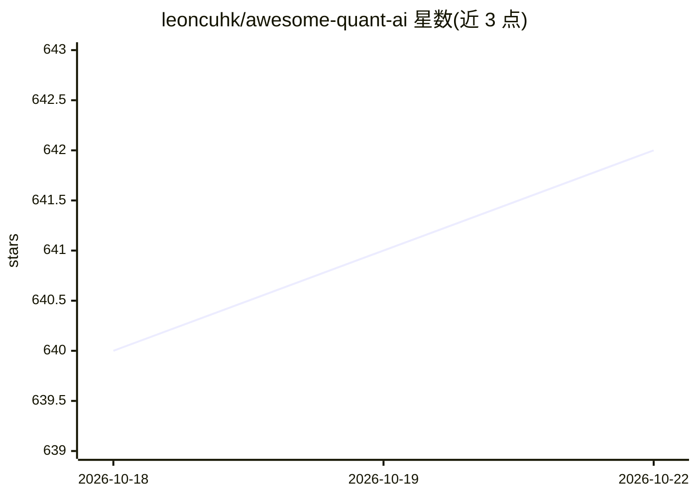

# leoncuhk/awesome-quant-ai

⭐ 642 · Jupyter Notebook · Apache-2.0 · 推送 2026-09-27 · [GitHub](https://github.com/leoncuhk/awesome-quant-ai) · 个人维护

**AI/ML 量化投资与交易策略的资源策展清单**

面向量化投资与 AI/ML 交叉领域研究者的策展清单：介绍量化金融的关键挑战、AI/ML 技术适配（监督学习、强化学习、生成模型、LLM）与数学基础，随后按统计套利、因子投资、高频交易、趋势跟踪、波动率交易、风险平价、宏观与事件驱动、机器学习策略等 9 类组织策略说明，每类附关键论文与开源资源（如 Hummingbot、pysystemtrade、Kenneth French 数据库），并给出量化系统设计的七步方法论与 Regime Research 页面链接。

## 筛选速览

| 维度 | 判定 | 备注 |
|---|---|---|
| AI 角色 | `ai-knowledge` | 知识聚合/清单类 |
| 许可风险 | `permissive` | Apache-2.0 |
| 部署形态 | `None` |  |
| 模型依赖 | — | README 未给出锁定关系 |
| 硬件要求 | — | 无带数字的原话,不猜 |
| 安装摩擦 | `low` | 无编译、无系统依赖或容器化 |
| 成熟度 | — | 结构信号不足 |

## 能力要点

- 按 9 类量化交易策略组织条目，附关键论文与开源资源
- 覆盖 AI/ML 技术适配分析（监督/无监督/强化学习/生成模型/LLM）
- 提供量化系统设计的七步方法论（目标定义到持续监控）
- 链接 Regime Research 每日市场状态页面

## 适用场景

- 系统学习量化投资与 AI/ML 结合的知识地图
- 按策略类型查找关键论文与开源实现
- 参考量化系统设计的流程方法论

## 场景标签

`精选清单` `金融量化` · 领域:学习与行业

## 证据(README 行号)

> L5: A curated list of awesome resources for quantitative investment and trading strategies focusing on artificial intell
> L17: Quantitative investing uses mathematical models and algorithms to determine investment opportunities. This reposito

## 星数曲线

2026-10-18 640 → 2026-10-22 642（+2）

---
*卡片 v1 · prompt 1.4 · 生成 2026-10-21 · 置信度 high · 依据 README sha `ee8cf1785772` · [字段定义](../../DATASET.md)*
