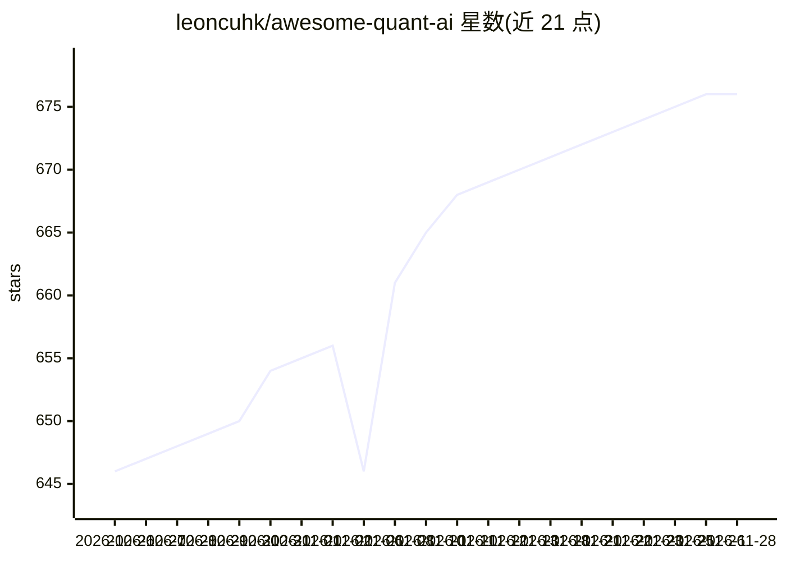

# leoncuhk/awesome-quant-ai

⭐ 676 · Jupyter Notebook · Apache-2.0 · 推送 2026-11-15 · [GitHub](https://github.com/leoncuhk/awesome-quant-ai) · 个人维护

**聚焦 AI/ML 应用于量化投资的资源策展清单**

面向量化投资与交易策略的资源清单，收录 AI 与机器学习在金融领域应用的相关资料。内容按统计套利、因子投资、高频交易、趋势跟踪、波动率交易、风险平价、宏观策略、事件驱动与机器学习策略等类别组织，每类给出方法描述与文献/开源资源条目（如 Hummingbot、pysystemtrade、Kenneth French 数据库）。另包含量化系统设计的流程章节（目标定义、因子研究、回测验证、风险管理、部署监控）与数学基础介绍。

## 筛选速览

| 维度 | 判定 | 备注 |
|---|---|---|
| AI 角色 | `ai-knowledge` | 知识聚合/清单类 |
| 许可风险 | `permissive` | Apache-2.0 |
| 部署形态 | `None` |  |
| 模型依赖 | — | README 未给出锁定关系 |
| 硬件要求 | — | 无带数字的原话,不猜 |
| 安装摩擦 | `low` | 无编译、无系统依赖或容器化 |
| 成熟度 | — | 结构信号不足 |

## 能力要点

- 按 9 类量化策略组织资源与文献条目
- 涵盖监督学习、强化学习、生成模型、LLM 在金融中的技术分类（L26-L30）
- 包含从 alpha 研究到部署监控的量化系统设计流程（L43-L76）

## 适用场景

- 查找量化投资与 AI 结合的学习资料和论文
- 按策略类型检索开源量化框架与数据源
- 了解量化策略研究的完整流程框架

## 场景标签

`精选清单` `金融量化` `科研工具` · 领域:学习与行业

## 证据(README 行号)

> L5: A curated list of awesome resources for quantitative investment and trading strategies focusing on artificial intell
> L17: Quantitative investing uses mathematical models and algorithms to determine investment opportunities. This reposito

## 星数曲线

2026-10-26 646 → 2026-11-28 676（+30）

---
*卡片 v1 · prompt 1.4 · 生成 2026-11-24 · 置信度 high · 依据 README sha `8d1eedf21676` · [字段定义](../../DATASET.md)*
