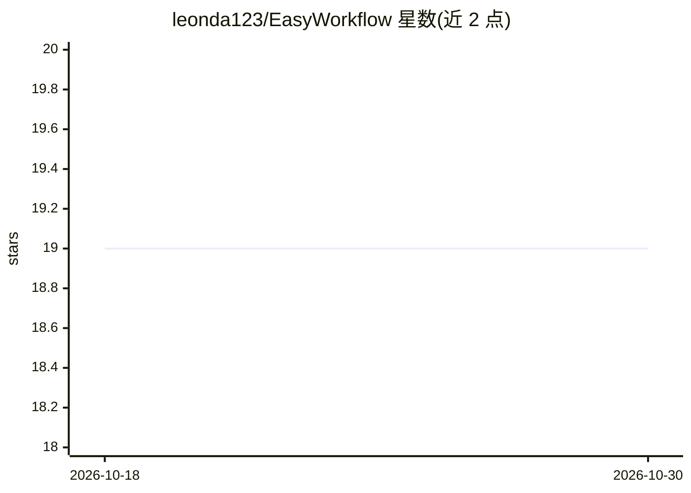

# leonda123/EasyWorkflow

⭐ 19 · TypeScript · MIT · 推送 2026-02-24 · [GitHub](https://github.com/leonda123/EasyWorkflow) · 个人维护 · 中文 README

**企业级私有部署的低代码 AI 工作流编排平台**

基于 React/React Flow 与 NestJS 构建的低代码工作流编排平台，面向企业私有部署场景：提供可视化拖拽编辑器、RabbitMQ 异步任务队列、多 LLM 提供商接入（含 Ollama/vLLM 等自定义端点）、发布版本管理与回滚、执行追踪与统计、全局与工作流级 API Key 管理，以及将 API 文档/cURL 转换为 HTTP 节点的 AI 节点生成功能。技术栈为 React 19 + NestJS 11 + Prisma 5 + MySQL 8.0 + RabbitMQ，支持 npm 本地开发与 Docker Compose 部署，中英双语界面。

## 筛选速览

| 维度 | 判定 | 备注 |
|---|---|---|
| AI 角色 | `ai-ecosystem` | LLM/agent 周边工具 |
| 许可风险 | `permissive` | MIT |
| 部署形态 | `self-host` | docker 或自建部署 |
| 模型依赖 | local-ok | 支持本地模型 |
| 硬件要求 | — | 无带数字的原话,不猜 |
| 安装摩擦 | `low` | 无编译、无系统依赖或容器化 |
| 成熟度 | — | 结构信号不足 |

## 能力要点

- 多 LLM 提供商接入，支持 Ollama/vLLM 等自定义模型端点
- RabbitMQ 异步任务处理与队列监控
- 发布版本管理、一键回滚与执行追踪统计
- API 文档/cURL 自动转换为 HTTP 请求节点

## 适用场景

- 在企业内网私有部署低代码 AI 工作流平台
- 编排包含 LLM 调用、HTTP 请求与定时触发的自动化流程
- 通过全局/工作流级 API Key 对外提供流程调用

## 场景标签

`工作流自动化` · 领域:效率与自动化

## 证据(README 行号)

> L6: A high-performance, enterprise-grade low-code workflow orchestration platform built with React and React Flow.
> L57: - Support for multiple LLM providers (OpenAI, Gemini, Azure, local models, etc.)

## 星数曲线

2026-10-18 19 → 2026-10-30 19（+0）

---
*卡片 v1 · prompt 1.4 · 生成 2026-10-28 · 置信度 high · 依据 README sha `f67552398003` · [字段定义](../../DATASET.md)*
