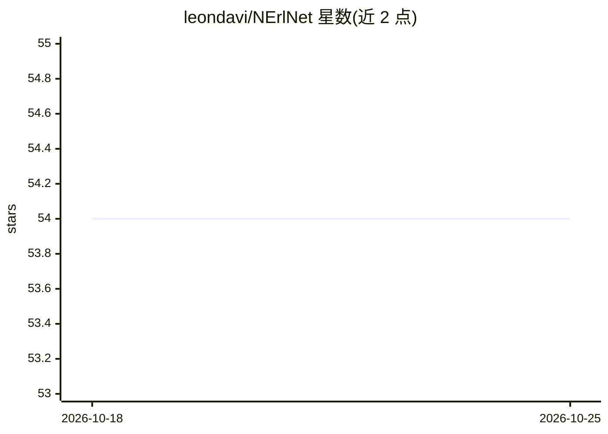

# leondavi/NErlNet

⭐ 54 · Python · GPL-3.0 · 推送 2026-03-08 · [GitHub](https://github.com/leondavi/NErlNet) · 个人维护

**在 IoT 设备上研究部署分布式机器学习的框架**

开源分布式机器学习框架，面向在 IoT 边缘设备上研究、模拟与部署分布式 ML 集群。通信层基于 Erlang 的 Cowboy，边缘侧神经网络基于 OpenNN 与 LibTorch，Flask HTTP 服务器管理集群实体；可在单机或多机上模拟 Source/Router/Client 架构的集群，再以少量修改部署到各类 IoT 设备。提供 Python API 与 Jupyter Notebook 收集消息数、吞吐、损失、预测、模型性能等指标。构建需 CMake、Erlang/OTP、gcc 等环境，通过安装脚本与 shell 脚本运行。

## 筛选速览

| 维度 | 判定 | 备注 |
|---|---|---|
| AI 角色 | `ai-ecosystem` | LLM/agent 周边工具 |
| 许可风险 | `viral` | GPL-3.0 |
| 部署形态 | `None` |  |
| 模型依赖 | — | README 未给出锁定关系 |
| 硬件要求 | — | 无带数字的原话,不猜 |
| 安装摩擦 | `medium` | 含编译或系统依赖之一 |
| 成熟度 | — | 结构信号不足 |

## 能力要点

- 在单机或多机模拟 Source/Router/Client 分布式 ML 集群并部署到 IoT 设备
- 边缘神经网络基于 OpenNN 与 LibTorch，通信层基于 Cowboy（Erlang）
- NerlPlanner 工具生成分布式配置、连接图与实验流程 JSON
- Python API + Jupyter 收集吞吐、损失、预测等集群指标

## 适用场景

- 在 IoT 边缘设备上运行和监控分布式神经网络训练/预测实验
- 先在单机模拟分布式 ML 集群再迁移到真实设备
- 收集分布式 ML 网络的通信与模型性能统计

## 场景标签

`模型训练` `MLOps` · 领域:训练与推理

## 证据(README 行号)

> L11: Nerlnet is an open-source framework designed for researching and deploying distributed machine learning algorithms 
> L13: By streamlining the setup of distributed clusters composed of multiple edge models, Nerlnet provides full control a
> L17: • ML on the edge of the distributed cluster is based on OpenNN library, an open-source project of Cpp Neural Networ

## 星数曲线

2026-10-18 54 → 2026-10-25 54（+0）

---
*卡片 v1 · prompt 1.4 · 生成 2026-10-24 · 置信度 high · 依据 README sha `440a0dadddad` · [字段定义](../../DATASET.md)*
