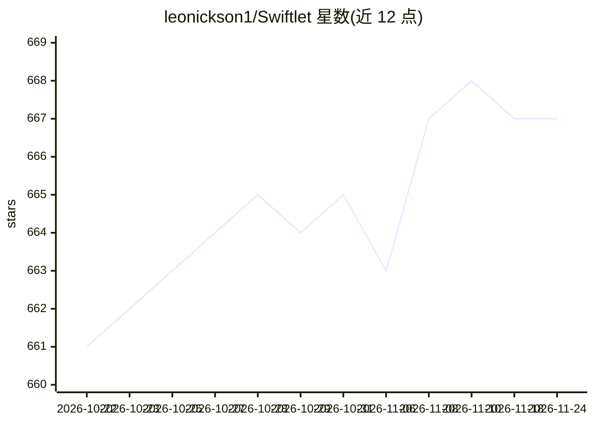

# leonickson1/Swiftlet

⭐ 666 · Swift · Apache-2.0 · 推送 2026-11-17 · [GitHub](https://github.com/leonickson1/Swiftlet) · 个人维护

**在 Apple 设备低内存运行大 MoE Qwen 模型的运行时**

Swift + Metal 编写的 Qwen3-Next / Qwen3.5/3.6 MoE 混合模型本地推理运行时：常驻约 1.3 GB 稠密核心，将路由专家权重打包为 .qpack 容器按需从 SSD 读取，配合 LRU 专家缓存，使 35B/80B 4-bit 模型可在低内存设备（含 iPhone）上运行。提供 Swift 包、CLI、回环 OpenAI 兼容服务器与 iPhone 应用四种使用方式；每层前向传播与 mlx-lm 参考实现做逐层验证。要求 Apple Silicon、macOS 14+/iOS 17+ 与足够 SSD 空间；仅约 3B 参数激活，作者声明事实召回能力受限于激活参数量。

## 筛选速览

| 维度 | 判定 | 备注 |
|---|---|---|
| AI 角色 | `ai-ecosystem` | LLM/agent 周边工具 |
| 许可风险 | `permissive` | Apache-2.0 |
| 部署形态 | `None` |  |
| 模型依赖 | — | README 未给出锁定关系 |
| 硬件要求 | — | 无带数字的原话,不猜 |
| 安装摩擦 | `low` | 无编译、无系统依赖或容器化 |
| 成熟度 | — | 结构信号不足 |

## 能力要点

- 稠密核心常驻内存，专家权重从 SSD 按 pread 流式读取，无 mmap
- 8 GB LRU 专家缓存命中 92%（35B）/ 83%（80B）的专家加载
- swiftlet-server 提供回环 OpenAI chat-completions 兼容 API
- 逐层对照 mlx-lm 参考实现的正确性测试套件

## 适用场景

- 在内存不足的 Mac 或 iPhone 上本地运行 35B/80B Qwen MoE 模型
- 为 OpenAI 兼容的聊天前端提供本地流式推理后端
- 把 SwiftletCore 嵌入 macOS/iOS 应用实现本地聊天与流式输出
- 从 MLX/HF 检查点重打包 .qpack 容器并跑基准测试

## 场景标签

`推理引擎` · 领域:训练与推理

## 证据(README 行号)

> L17: Swiftlet is a Swift + Metal runtime for the Qwen3-Next and Qwen3.5/3.6 MoE
> L143: 3. **The server.** `swiftlet-server` speaks the OpenAI chat-completions API

## 星数曲线

2026-10-22 661 → 2026-11-24 667（+6）

---
*卡片 v1 · prompt 1.4 · 生成 2026-11-24 · 置信度 high · 依据 README sha `25f01967a28a` · [字段定义](../../DATASET.md)*
