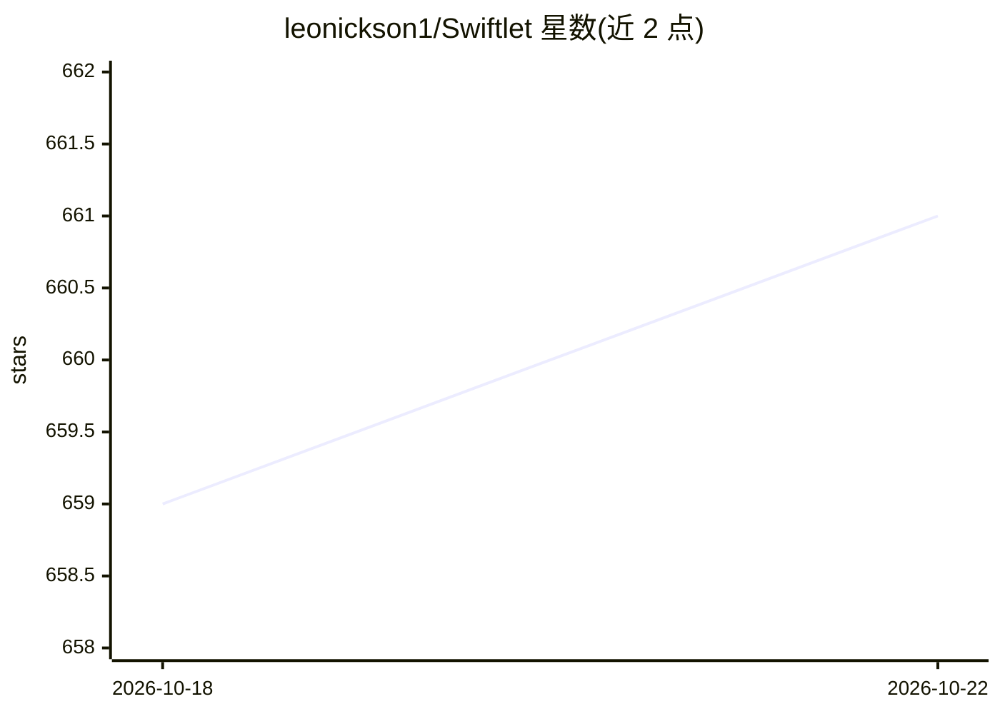

# leonickson1/Swiftlet

⭐ 662 · Swift · Apache-2.0 · 推送 2026-09-27 · [GitHub](https://github.com/leonickson1/Swiftlet) · 个人维护

**在 Apple 设备上流式运行 Qwen MoE 大模型的 Swift/Metal 运行时**

面向 Apple Silicon（macOS 14+ / iOS 17+）的 Swift + Metal 本地推理运行时，支持 Qwen3-Next 与 Qwen3.5/3.6 MoE 混合模型族。机制上仅将稠密核心常驻内存，路由专家权重以固定步长打包为 .qpack 容器并按需从 SSD 单次 pread 流式读取，配合 LFU+recency 有界缓存，使 35B/80B 模型在低 RAM（如 iPhone 2.5 GB）下运行。提供 Swift 库（SwiftletSession）、CLI、兼容 OpenAI chat-completions 的本地 server，以及 iOS 应用 Priv AI（App Store / 开源 localLLM）。限制：仅约 3B 参数每 token 激活，事实回忆能力相当于小模型；需 Apple Silicon 与充足 SSD 空间。

## 筛选速览

| 维度 | 判定 | 备注 |
|---|---|---|
| AI 角色 | `ai-ecosystem` | LLM/agent 周边工具 |
| 许可风险 | `permissive` | Apache-2.0 |
| 部署形态 | `None` |  |
| 模型依赖 | — | README 未给出锁定关系 |
| 硬件要求 | — | 无带数字的原话,不猜 |
| 安装摩擦 | `low` | 无编译、无系统依赖或容器化 |
| 成熟度 | — | 结构信号不足 |

## 能力要点

- 稠密核心常驻内存，专家权重从 SSD 单次 pread 流式加载
- 35B/80B/397B MoE 模型低 RAM 运行（80B 8-bit 以 6.9 GiB 服务）
- 提供 Swift 包、CLI、OpenAI 兼容本地 server、iOS 应用四种使用方式
- 逐层对照 mlx-lm 参考实现验证前向计算正确性

## 适用场景

- 在内存有限的 Mac 或 iPhone 上本地运行 35B/80B Qwen 模型
- 让任意 OpenAI 兼容的聊天 UI 连接本地流式模型
- 把 SwiftletCore 嵌入自己的 macOS/iOS 应用做端侧对话

## 场景标签

`推理引擎` · 领域:训练与推理

## 证据(README 行号)

> L16: Swiftlet is a Swift + Metal runtime for the Qwen3-Next and Qwen3.5/3.6 MoE
> L124: 3. **The server.** `swiftlet-server` speaks the OpenAI chat-completions API
> L117: 1. **The Swift package.** Add SwiftletCore to any macOS or iOS app and use

## 星数曲线

2026-10-18 659 → 2026-10-22 661（+2）

---
*卡片 v1 · prompt 1.4 · 生成 2026-10-21 · 置信度 high · 依据 README sha `8640e3f3b530` · [字段定义](../../DATASET.md)*
