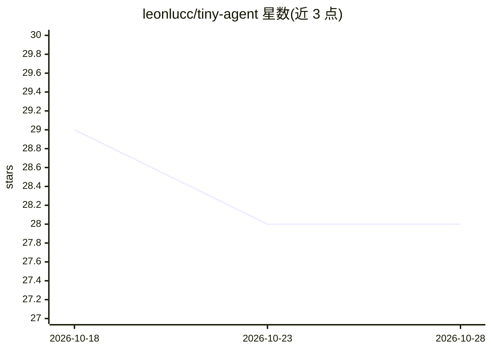

# leonlucc/tiny-agent

⭐ 28 · JavaScript · 推送 2026-08-06 · [GitHub](https://github.com/leonlucc/tiny-agent) · [官网](https://tinyagent.leonlu.cc) · 个人维护 · 中文 README

**从零手写 AI Agent 的渐进式教学项目与配套教程**

轻量级 AI 智能体开源项目，同时是与源码同步演进的渐进式开发教程：从最简单的 LLM 调用开始，逐步构建具备感知、记忆、规划、行动能力的智能体，覆盖 ReAct、长记忆、多智能体等链路。零重型框架依赖，LLM、向量库、工具调用、记忆模块解耦可替换；单进程同时托管原生 HTML 前端与 FastAPI 后端，一键启动。每个 Git Tag 均为独立可运行版本。README 明确本项目侧重教学，生产场景建议选用 LangChain 等框架。

## 筛选速览

| 维度 | 判定 | 备注 |
|---|---|---|
| AI 角色 | `ai-knowledge` | 知识聚合/清单类 |
| 许可风险 | `none` | — |
| 部署形态 | `None` |  |
| 模型依赖 | — | README 未给出锁定关系 |
| 硬件要求 | — | 无带数字的原话,不猜 |
| 安装摩擦 | `low` | 无编译、无系统依赖或容器化 |
| 成熟度 | — | 结构信号不足 |

## 能力要点

- 零重型框架依赖的单文件模块实现，注释完整
- LLM、向量库、工具调用、记忆模块解耦，支持替换与扩展
- 单进程托管前后端，无需前端打包工具一键启动
- 每个 Git Tag 独立可运行，支持分版本渐进学习

## 适用场景

- 从零理解 ReAct、RAG 和工具调用的底层原理
- 逐版本跟写并调试一个可运行的 Agent
- 快速本地验证 Agent 相关想法，无需搭建前端环境

## 场景标签

`教程课程` · 领域:学习与行业

## 证据(README 行号)

> L11: Tiny Agent 是一个轻量级的 AI 智能体开源项目，也是一本与源码同步演进的渐进式开发教程。项目遵循**由浅入深、循序渐进**的设计理念，不依赖复杂框架，从一次最简单的大模型调用开始，逐步构建出一个具备感知、记忆、规划、行
> L59: Tiny Agent 核心目标优先服务教学与原理学习，而非商用复杂业务落地：

## 星数曲线

2026-10-18 29 → 2026-10-28 28（-1）

---
*卡片 v1 · prompt 1.4 · 生成 2026-10-26 · 置信度 high · 依据 README sha `849b213762fb` · [字段定义](../../DATASET.md)*
