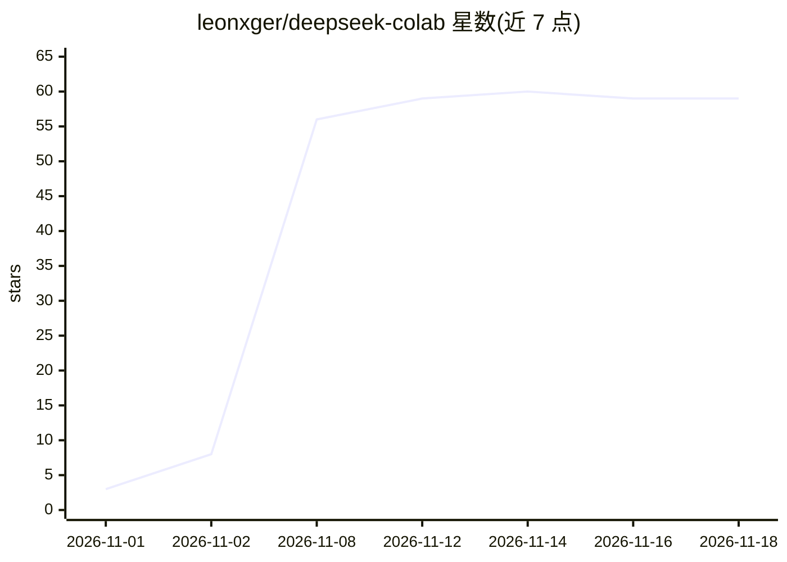

# leonxger/deepseek-colab

⭐ 59 · Python · MIT · 推送 2026-10-30 · [GitHub](https://github.com/leonxger/deepseek-colab) · 个人维护

**在 Colab G4 GPU 上部署 DeepSeek V4.1 Flash 无审查模型的启动器**

本地运行的 Python 脚本（llm.py），通过 SSH 隧道连接 Google Colab G4 GPU 虚拟机，部署 2-bit 量化（IQ2_XS/GSQ-RCO）的 DeepSeek V4.1 Flash 无审查模型，对外提供 OpenAI 兼容端点。关键机制：最热的 7,800 个专家驻留 GPU，其余置于 RAM 并按需经 PCIe 复制；草稿模型两 token 前瞻推测解码；llama.cpp 打 22 个补丁。限制：需 Google AI Pro 或 Colab Pro 订阅，约每小时 9 计算单元；10 分钟无请求自动停机。文本模式最高 131K 上下文、约 118.7 tok/s。

## 筛选速览

| 维度 | 判定 | 备注 |
|---|---|---|
| AI 角色 | `ai-ecosystem` | LLM/agent 周边工具 |
| 许可风险 | `permissive` | MIT |
| 部署形态 | `None` |  |
| 模型依赖 | local-ok | 支持本地模型 |
| 硬件要求 | — | 无带数字的原话,不猜 |
| 安装摩擦 | `low` | 无编译、无系统依赖或容器化 |
| 成熟度 | — | 结构信号不足 |

## 能力要点

- 一条命令在 Colab G4 GPU 上启动 OpenAI 兼容端点
- 专家分层驻留：热门 7,800 专家在 GPU，其余在 190 GB RAM 按需复制
- 草稿模型推测解码与 llama.cpp 22 个补丁，文本模式达 118.7 tok/s
- 10 分钟空闲自动停止 GPU，下次请求自动唤醒

## 适用场景

- 无自建服务器、凭 Colab 订阅运行 249 GB 的 DeepSeek V4.1 Flash
- 把端点接入 Open WebUI、OpenAI SDK 或 curl 使用
- 需要图像输入或 262K 上下文的本地化推理

## 场景标签

`推理引擎` · 领域:训练与推理

## 证据(README 行号)

> L3:  The uncensored 249 GB model as your own OpenAI-compatible endpoint, at over 100 tokens a second.
> L27: The last line stays live: GPU on or off, the countdown to the automatic stop, the cost so far. Paste the base URL a
> L54: Your computer runs llm.py, a local OpenAI endpoint, connected through an SSH tunnel to a Google Colab G4 VM. The GP

## 星数曲线

2026-11-01 3 → 2026-11-18 59（+56）

---
*卡片 v1 · prompt 1.4 · 生成 2026-11-18 · 置信度 high · 依据 README sha `fd76b45a3ac1` · [字段定义](../../DATASET.md)*
