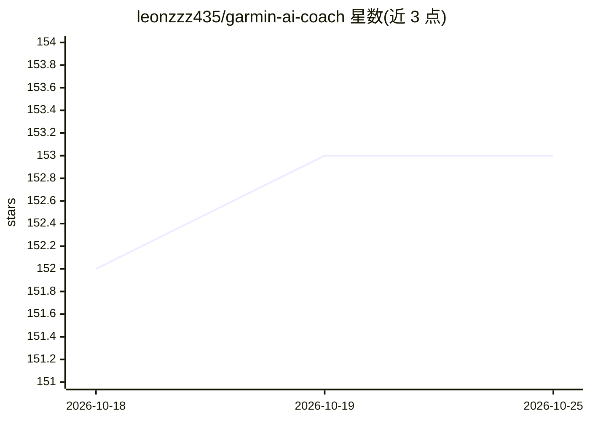

# leonzzz435/garmin-ai-coach

⭐ 154 · Python · MIT · 推送 2026-01-31 · [GitHub](https://github.com/leonzzz435/garmin-ai-coach) · 个人维护

**把 Garmin Connect 数据变成 AI 训练分析与赛季计划报告的 CLI 工具**

Python 编写的 CLI 工具，读取 Garmin Connect 训练数据，经 LangGraph 多智能体工作流（摘要器→专家→规划）生成 HTML 训练分析报告与赛季策略加 4 周计划，支持可选的人在环提问与 Outside 赛事导入。提供商支持 OpenAI、Anthropic、OpenRouter（可路由 DeepSeek/Gemini/Grok），可选 LangSmith 追踪与成本统计。默认经 Pixi 安装运行，也可 pip 装依赖后运行 CLI。CLI 本地运行无第一方后端，但数据会发送至所配置的 LLM 提供商；声明与 Garmin 无关、非医疗建议。

## 筛选速览

| 维度 | 判定 | 备注 |
|---|---|---|
| AI 角色 | `ai-native` | 本体是模型或模型工具 |
| 许可风险 | `permissive` | MIT |
| 部署形态 | `library` | 以包/库形式分发 |
| 模型依赖 | locked-api |  |
| 硬件要求 | — | 无带数字的原话,不猜 |
| 安装摩擦 | `low` | 无编译、无系统依赖或容器化 |
| 成熟度 | — | 结构信号不足 |

## 能力要点

- LangGraph 多智能体工作流生成训练分析（analysis.html）与赛季计划（planning.html）
- 支持 OpenAI / Anthropic / OpenRouter（DeepSeek/Gemini/Grok）多提供商与 API key 配置
- 可选人在环提问、Outside 赛事导入、LangSmith 追踪与成本统计
- CLI 本地运行，无第一方后端，输出写入本机

## 适用场景

- 我想把 Garmin 训练数据生成一份循证训练分析报告
- 需要一份带比赛锚点的赛季策略和 4 周训练计划
- 想用自己选择的 LLM 提供商跑耐力训练教练流程

## 场景标签

`数据分析` · 领域:效率与自动化

## 证据(README 行号)

> L3: > CLI-first tool that turns Garmin Connect data into:
> L8: > Powered by a LangGraph multi-agent workflow with optional human-in-the-loop (HITL) questions.
> L14: **Providers:** OpenAI, Anthropic, and OpenRouter (DeepSeek/Gemini/Grok via OpenRouter).

## 星数曲线

2026-10-18 152 → 2026-10-25 153（+1）

---
*卡片 v1 · prompt 1.4 · 生成 2026-10-22 · 置信度 high · 依据 README sha `f7094c8a55c0` · [字段定义](../../DATASET.md)*
