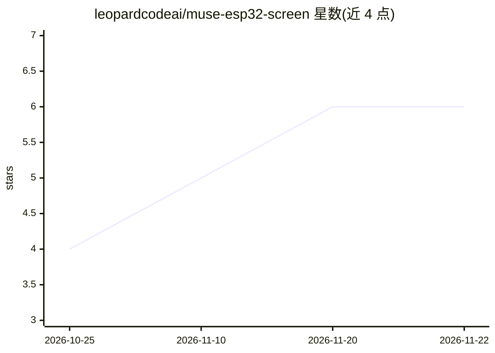

# leopardcodeai/muse-esp32-screen

⭐ 6 · JavaScript · Apache-2.0 · 推送 2026-11-20 · [GitHub](https://github.com/leopardcodeai/muse-esp32-screen) · [官网](https://blog.leopardcode.ai/en/esp32-box-as-the-body-of-an-always-on-agent/) · 个人维护

**为 AI 助手提供 ESP32 屏幕界面的开源固件与网页镜像**

基于 ESPHome 与 Home Assistant 的固件项目：把 ESP32-S3-BOX-3 或 ESP32-S31 变成 AI 助手的显示屏，助手通过调用 Home Assistant 动作驱动 22 个动作（显示文本/天气/路线、按钮提问、场景绘制、计时器等），屏幕硬件与浏览器版 Muse Web Screen 使用同一套解析代码镜像相同内容。唤醒词在设备本地运行，对话走 Home Assistant 语音管线（本地或云端）。支持 Meta Muse、Claude 或任何可调用 API 的 agent。

## 筛选速览

| 维度 | 判定 | 备注 |
|---|---|---|
| AI 角色 | `ai-enhanced` | 去掉 AI 部分产品仍成立 |
| 许可风险 | `permissive` | Apache-2.0 |
| 部署形态 | `None` |  |
| 模型依赖 | — | README 未给出锁定关系 |
| 硬件要求 | — | 无带数字的原话,不猜 |
| 安装摩擦 | `low` | 无编译、无系统依赖或容器化 |
| 成熟度 | — | 结构信号不足 |

## 能力要点

- 22 个 Home Assistant 动作控制屏幕卡片、提问按钮与计时器
- muse_draw 场景绘制语言：273 图标、渐变、粒子等，助手可自行设计屏幕
- 同一代码在 ESP32 硬件与浏览器 twin 中渲染相同卡片
- 唤醒词在设备本地运行，局域网内加密通信

## 适用场景

- 给家里的 AI 助手配一块可触摸交互的实体屏幕
- 让助手用按钮向家人提问并接收回答
- 无硬件时在浏览器标签页体验相同卡片界面

## 场景标签

`AI 助手` · 领域:对话与助手

## 证据(README 行号)

> L19: - **Shows what the assistant says:** text, a value, the weather, the doorbell, photos, GIFs, a live camera, a route
> L67: The assistant never talks to the box directly. It calls Home Assistant actions with a long-lived token; Home Assist
> L91: One assistant, many hands. An Espressif ESP32-S3-BOX-3 (a 2.4 inch touch screen, two microphones, a speaker, and a 

## 星数曲线

2026-10-25 4 → 2026-11-22 6（+2）

---
*卡片 v1 · prompt 1.4 · 生成 2026-11-20 · 置信度 high · 依据 README sha `122e567d39d9` · [字段定义](../../DATASET.md)*
