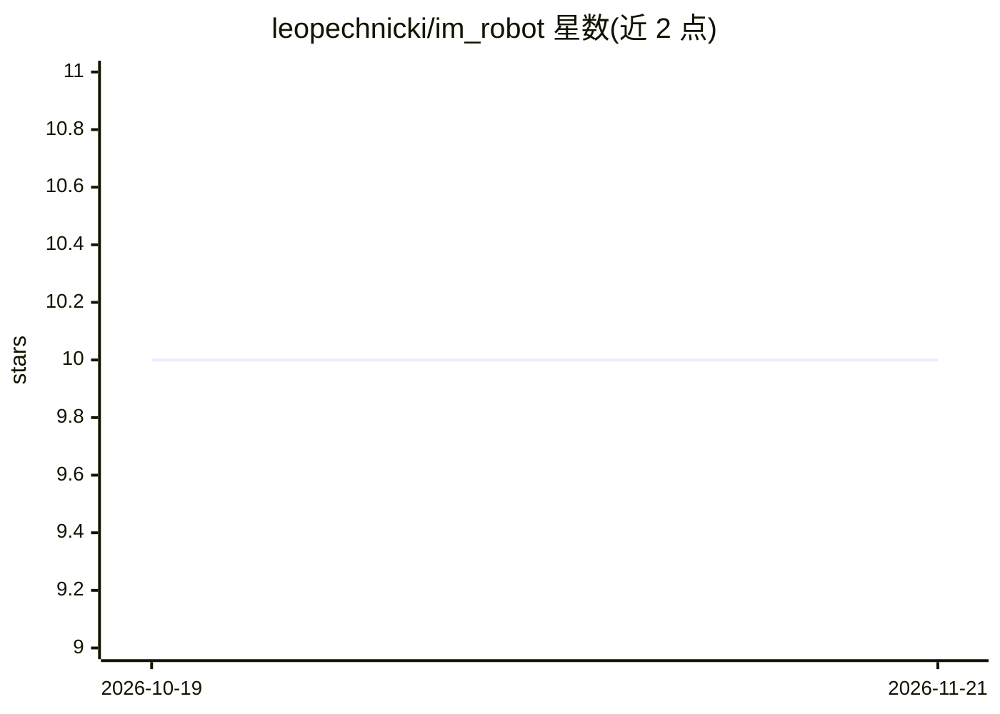

# leopechnicki/im_robot

⭐ 10 · TypeScript · MIT · 推送 2026-11-03 · [GitHub](https://github.com/leopechnicki/im_robot) · [官网](https://imrobot.vercel.app) · 个人维护

**反向验证码 SDK：验证网站访客是合法 AI Agent 而非人类**

imrobot 提供 npm 与 pip 双 SDK，生成由确定性操作（字符串变换、字节运算、哈希等）组成的挑战管线，AI Agent 从 DOM 中的结构化 JSON 解析挑战、执行管线并提交答案（官方称 <1 秒可解），人类手动完成多步变换则不现实。服务器端以 HMAC-SHA256 签名做无状态校验（无数据库依赖），验证通过签发 Proof-of-Agent 令牌；附带 Express/Hono/Next.js 适配器、内存限流、截图模糊防护、`.well-known/imrobot.json` Agent 发现端点及测试用 CLI。

## 筛选速览

| 维度 | 判定 | 备注 |
|---|---|---|
| AI 角色 | `ai-ecosystem` | LLM/agent 周边工具 |
| 许可风险 | `permissive` | MIT |
| 部署形态 | `library` | 以包/库形式分发 |
| 模型依赖 | — | README 未给出锁定关系 |
| 硬件要求 | — | 无带数字的原话,不猜 |
| 安装摩擦 | `low` | 无编译、无系统依赖或容器化 |
| 成熟度 | — | 结构信号不足 |

## 能力要点

- 确定性挑战管线：Agent 解析 JSON 并执行变换，<1 秒求解
- HMAC-SHA256 无状态服务端校验与 Proof-of-Agent 令牌（X-Agent-Proof 头）
- 提供 React/Vue/Svelte/Web Components 组件与 Express、Hono、Next.js 适配器
- 挑战默认模糊显示并检测截图快捷键；Agent 读 DOM 不受影响

## 适用场景

- 为仅限 Agent 访问的 API 端点加一道机器可解的人不可解验证
- 搭建面向 AI Agent 的平台并自动签发凭证令牌
- 通过 .well-known 发现文档让 Agent 自动完成接入流程
- 在 CI 中用 CLI 检测目标站点是否声明支持 imrobot 协议

## 场景标签

`网络安全` · 领域:学习与行业

## 证据(README 行号)

> L19: As AI agents become first-class web citizens — browsing, booking, purchasing, automating — some systems need to
> L41: npm install imrobot                # JS/TS SDK (Node, Bun, Deno, Cloudflare Workers, browsers)
> L109: Protect your API endpoints with framework-agnostic middleware. Verified agents receive a JWT-like Proof-of-Agent t

## 星数曲线

2026-10-19 10 → 2026-11-21 10（+0）

---
*卡片 v1 · prompt 1.4 · 生成 2026-11-19 · 置信度 high · 依据 README sha `5826d241b6e3` · [字段定义](../../DATASET.md)*
