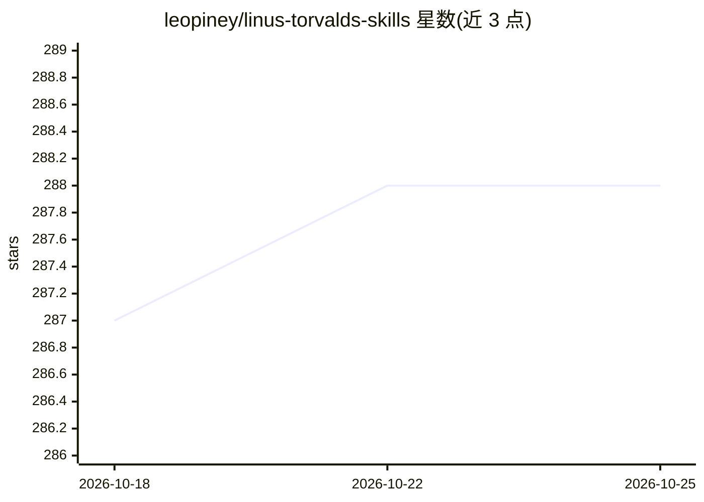

# leopiney/linus-torvalds-skills

⭐ 288 · 推送 2026-04-23 · [GitHub](https://github.com/leopiney/linus-torvalds-skills) · 个人维护 · 中文 README

**约束 AI 编程助手行为的单文件准则（CLAUDE.md）**

以 Linus Torvalds 的工程观点为来源编写的单一 CLAUDE.md 指令文件，用于改变 AI 编程助手的编码行为：包含数据结构优先、最小实现、只改必要代码、以测试/基准验证四个原则，附反模式清单（13 类）、Linux 风格评审评语与 LKML 风格短语表，并声明仅针对代码而非人身。安装方式为 npx skills add 或将 CLAUDE.md 下载/追加到项目根目录，另附 Cursor 项目规则文件。

## 筛选速览

| 维度 | 判定 | 备注 |
|---|---|---|
| AI 角色 | `ai-knowledge` | 知识聚合/清单类 |
| 许可风险 | `none` | — |
| 部署形态 | `library` | 以包/库形式分发 |
| 模型依赖 | — | README 未给出锁定关系 |
| 硬件要求 | — | 无带数字的原话,不猜 |
| 安装摩擦 | `low` | 无编译、无系统依赖或容器化 |
| 成熟度 | — | 结构信号不足 |

## 能力要点

- 四原则指令文件（Data First / Simplicity First / Surgical Changes / Show Me the Code）
- 13 类反工程模式检测清单与 LKML 风格评审短语表
- 提供 npx 安装或按项目放置/追加 CLAUDE.md 两种方式
- 附带 Cursor 项目规则文件（.cursor/rules/torvalds-doctrine.mdc）

## 适用场景

- 我在用 Claude Code 时想让改动更小、更少多余抽象
- 给项目的 AI 编程助手加一套数据结构优先的行为约束
- 在 Cursor 中自动应用这套准则

## 场景标签

`提示工程` · 领域:Agent 开发

## 证据(README 行号)

> L9: A single doctrine for making AI coding assistants behave more like Linus Torvalds: blunt, pragmatic, data-structure-
> L29: Four principles in one file that directly attack those failures:

## 星数曲线

2026-10-18 287 → 2026-10-25 288（+1）

---
*卡片 v1 · prompt 1.4 · 生成 2026-10-22 · 置信度 high · 依据 README sha `14019bee2276` · [字段定义](../../DATASET.md)*
