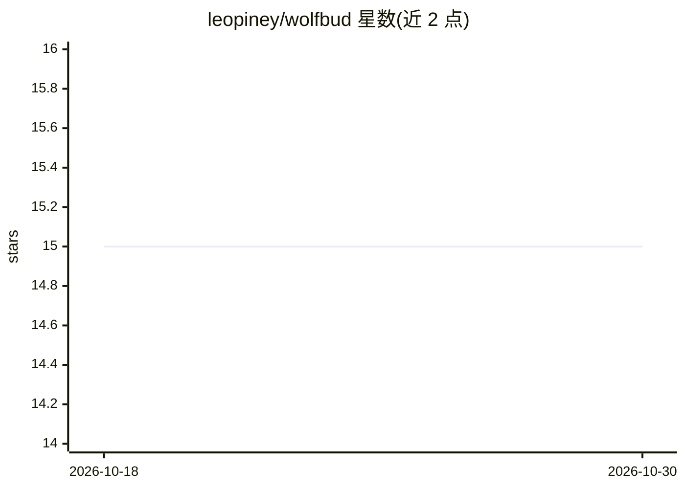

# leopiney/wolfbud

⭐ 15 · Vue · MIT · 推送 2026-08-04 · [GitHub](https://github.com/leopiney/wolfbud) · 个人维护

**macOS 菜单栏语音转文字与文字转语音应用**

基于 Tauri 的 macOS 菜单栏应用，通过 ElevenLabs Scribe v2 实时模型与用户自备的 API key 提供语音转文字（快捷键 ⌘ShiftSpace 录音，转录结果粘贴到当前应用）和文字转语音（朗读剪贴板文本，使用 ElevenLabs 声音）。功能包括浮动覆盖层实时显示转录、录音时自动压低系统音量。项目声明与 ElevenLabs 无关联。通过 Releases 页面下载 .dmg 安装，也可用 Rust/Node.js/pnpm 本地构建。

## 筛选速览

| 维度 | 判定 | 备注 |
|---|---|---|
| AI 角色 | `ai-native` | 本体是模型或模型工具 |
| 许可风险 | `permissive` | MIT |
| 部署形态 | `desktop` | 安装包/桌面程序 |
| 模型依赖 | — | README 未给出锁定关系 |
| 硬件要求 | — | 无带数字的原话,不猜 |
| 安装摩擦 | `low` | 无编译、无系统依赖或容器化 |
| 成熟度 | — | 结构信号不足 |

## 能力要点

- 快捷键触发的语音转文字，转录直接粘贴到当前应用
- 使用 ElevenLabs Scribe v2 实时模型，需自备 API key
- 浮动覆盖层实时显示转录，录音时自动压低系统音量
- 剪贴板文本用 ElevenLabs 声音朗读

## 适用场景

- 在任意 Mac 应用中通过快捷键做语音输入
- 朗读剪贴板中的文本内容
- 实时查看自己说话的转录内容

## 场景标签

`语音识别` `语音合成` · 领域:内容生成

## 证据(README 行号)

> L7: Wolfbud is a macOS menubar app that gives you **speech-to-text** and **text-to-speech** from anywhere on your Mac. I
> L9: - **Speech-to-Text** — Press **⌘ Shift Space** to start recording, speak, then press **⌘ Shift Space** again to stop

## 星数曲线

2026-10-18 15 → 2026-10-30 15（+0）

---
*卡片 v1 · prompt 1.4 · 生成 2026-10-30 · 置信度 mid · 依据 README sha `725fbe5624e6` · [字段定义](../../DATASET.md)*
