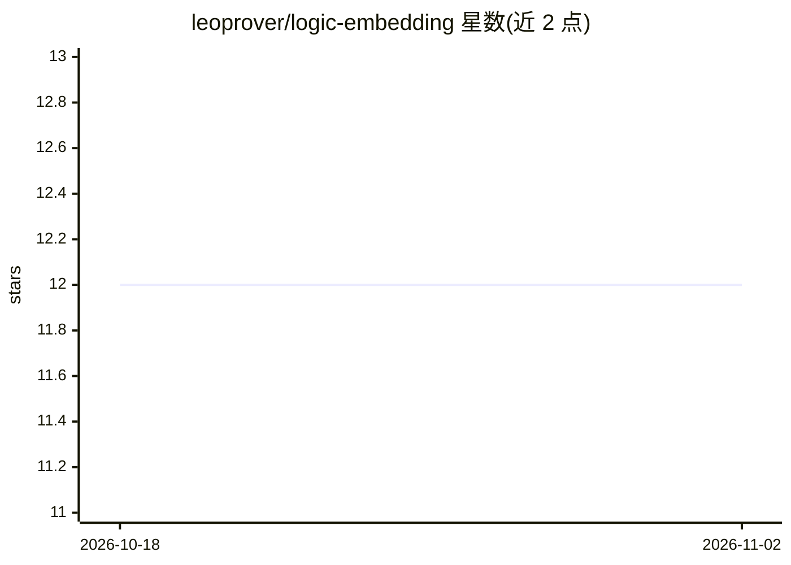

# leoprover/logic-embedding

⭐ 12 · Scala · BSD-3-Clause · 推送 2026-10-13 · [GitHub](https://github.com/leoprover/logic-embedding) · 个人维护

**将非经典逻辑 TPTP 问题编码为经典逻辑的工具与运行时库**

面向自动定理证明的翻译工具与 Scala 运行时库：读取以非经典逻辑（模态、混合逻辑、公开宣告逻辑、道义逻辑、规范元形式、依赖类型高阶逻辑等）表达的 TPTP 问题文件，按文件内的逻辑规格说明将其编码为经典高阶（THF）或一阶（TFF）逻辑，支持单态与多态类型。模态族支持域语义、rigid/flexible 指称、每个模态词独立指定公理系统等参数。提供可执行 JAR 与 Maven Central 发布的运行时库（Scala 2.13/3.9），可供 sbt/Maven 项目依赖。

## 筛选速览

| 维度 | 判定 | 备注 |
|---|---|---|
| AI 角色 | `ai-ecosystem` | LLM/agent 周边工具 |
| 许可风险 | `permissive` | BSD-3-Clause |
| 部署形态 | `None` |  |
| 模型依赖 | — | README 未给出锁定关系 |
| 硬件要求 | — | 无带数字的原话,不猜 |
| 安装摩擦 | `low` | 无编译、无系统依赖或容器化 |
| 成熟度 | — | 结构信号不足 |

## 能力要点

- 支持 9 类非经典逻辑族（模态、混合、PAL、DDL、规范元形式、DHoL 等）
- 翻译为经典 THF/TFF，支持单态与多态类型
- 模态逻辑支持域语义、指称方式、按模态词指定公理系统等参数化
- 以可执行 JAR 与 Maven Central 运行时库（Scala 2.13/3.9）两种形式提供

## 适用场景

- 把模态/道义等非经典逻辑问题转成经典逻辑后交给定理证明器处理
- 在 Scala 项目中以库的形式集成非经典逻辑编码能力
- 研究不同量化域语义与模态公理系统下的逻辑表达

## 场景标签

 · 领域:自动推理/非经典逻辑

## 证据(README 行号)

> L2: _A tool and runtime library for embedding non-classical logics into classical logics_
> L4: The tool translates a TPTP problem statement formulated in a non-classical logic
> L5: (using the logic specification format) into classical higher-order logic
> L6: (THF format) or first-order logic (TFF format), either using monomorphic or polymorphic types.

## 星数曲线

2026-10-18 12 → 2026-11-02 12（+0）

---
*卡片 v1 · prompt 1.4 · 生成 2026-11-01 · 置信度 high · 依据 README sha `288da49a27e3` · [字段定义](../../DATASET.md)*
