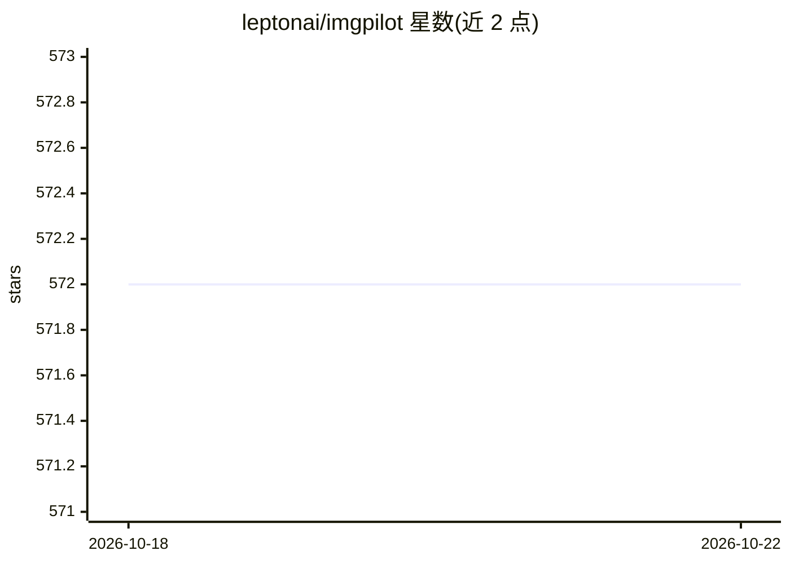

# leptonai/imgpilot

⭐ 572 · TypeScript · MIT · 推送 2026-01-31 · [GitHub](https://github.com/leptonai/imgpilot) · [官网](https://imgpilot.yadongxie.com) · 组织维护

**基于实时 LCM 的手绘图转艺术画 Web 应用**

LeptonAI 开源的图像生成 Web 应用：前端基于 Excalidraw 画布供用户绘制草图，后端运行 Real-Time Latent Consistency Model（LCM）将草图实时转化为图像作品，包含完整前后端代码。安装方式为 npm 安装前端依赖、pip 安装服务端依赖，通过 lep photon runlocal 启动服务、npm run dev 启动前端；支持本地与云端部署，README 声明完全基于开源、可用于商业目的。

## 筛选速览

| 维度 | 判定 | 备注 |
|---|---|---|
| AI 角色 | `ai-native` | 本体是模型或模型工具 |
| 许可风险 | `permissive` | MIT |
| 部署形态 | `library` | 以包/库形式分发 |
| 模型依赖 | — | README 未给出锁定关系 |
| 硬件要求 | — | 无带数字的原话,不猜 |
| 安装摩擦 | `low` | 无编译、无系统依赖或容器化 |
| 成熟度 | — | 结构信号不足 |

## 能力要点

- Excalidraw 前端画布 + LCM 后端的完整前后端代码
- 实时将手绘草稿转化为图像
- 支持本地与云端部署

## 适用场景

- 在浏览器中手绘草稿并实时生成图像作品
- 作为 LCM 实时生成的可部署应用模板

## 场景标签

`图像生成` · 领域:内容生成

## 证据(README 行号)

> L3: Image pilot with the power of Real-Time Latent Consistency Model.
> L43: - Real-Time-Latent-Consistency-Model

## 星数曲线

2026-10-18 572 → 2026-10-22 572（+0）

---
*卡片 v1 · prompt 1.4 · 生成 2026-10-21 · 置信度 high · 依据 README sha `fcfa1cc517fd` · [字段定义](../../DATASET.md)*
