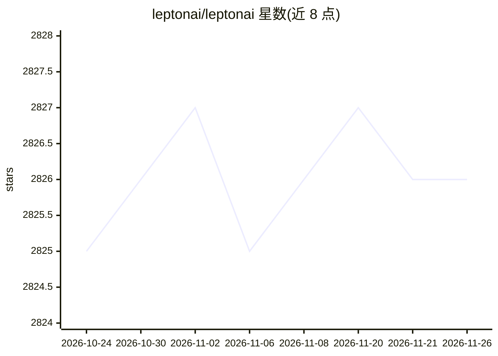

# leptonai/leptonai

⭐ 2,826 · Python · Apache-2.0 · 推送 2026-11-25 · [GitHub](https://github.com/leptonai/leptonai) · [官网](https://lepton.ai/) · 组织维护

**NVIDIA DGX Cloud Lepton 平台的 Python 库与 lep CLI**

LeptonAI Python 库与 lep 命令行工具，用于从 Python 和终端操作 NVIDIA DGX Cloud Lepton 平台。 lep CLI 管理端点、Dynamo 图部署、批处理作业、dev pod、Ray 集群、微调作业、存储与密钥，并检查托管 Slurm 集群；通过 Teleport 支持 pod/endpoint/job/Slurm 节点的交互式 shell，无需 SSH 公网地址；提供 token 认证与端点访问控制选项；Dynamo 部署支持 vLLM/SGLang/TensorRT-LLM 后端的多服务 LLM 推理配置；另提供让 Claude Code/Codex 等代理驱动 lep CLI 的技能插件。

## 筛选速览

| 维度 | 判定 | 备注 |
|---|---|---|
| AI 角色 | `ai-ecosystem` | LLM/agent 周边工具 |
| 许可风险 | `permissive` | Apache-2.0 |
| 部署形态 | `library` | 以包/库形式分发 |
| 模型依赖 | local-ok | 支持本地模型 |
| 硬件要求 | — | 无带数字的原话,不猜 |
| 安装摩擦 | `low` | 无编译、无系统依赖或容器化 |
| 成熟度 | — | 结构信号不足 |

## 能力要点

- lep CLI 管理端点、批作业、dev pod、Ray 集群、Slurm 等资源
- 通过 Teleport 的 HTTPS 隧道交互式 shell，无需 SSH key 与公网 IP
- Dynamo 图部署支持 vLLM/SGLang/TensorRT-LLM 后端与多节点 worker
- 提供 Claude Code/Codex/Cursor 的 agent 技能插件，以自然语言操作平台

## 适用场景

- 在 DGX Cloud Lepton 上部署与检查模型服务端点
- 从命令行提交批处理训练作业与开发 pod
- 配置多服务 LLM 推理的 Dynamo 图部署
- 让 AI 编码代理代为查看和管理云端工作负载

## 场景标签

 · 领域:云平台/模型部署基础设施

## 证据(README 行号)

> L10: The LeptonAI Python library lets you operate the NVIDIA DGX Cloud Lepton platform from Python and the command line.
> L14: - Skills that let agents operate the Lepton platform for you.
> L205: Dynamo graph deployments (multi-service LLM inference with a vLLM, SGLang, or

## 星数曲线

2026-10-24 2,825 → 2026-11-26 2,826（+1）

---
*卡片 v1 · prompt 1.4 · 生成 2026-11-23 · 置信度 high · 依据 README sha `d5aaa7e1eab1` · [字段定义](../../DATASET.md)*
