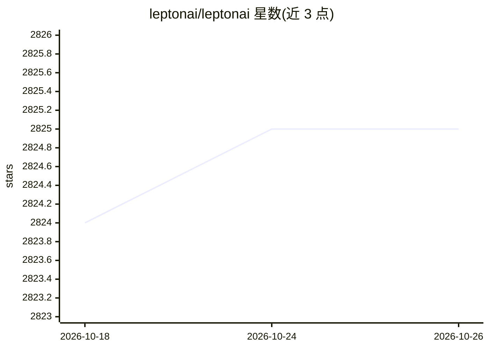

# leptonai/leptonai

⭐ 2,825 · Python · Apache-2.0 · 推送 2026-10-25 · [GitHub](https://github.com/leptonai/leptonai) · [官网](https://lepton.ai/) · 组织维护

**操作 NVIDIA DGX Cloud Lepton 平台的 Python 库与 lep CLI**

LeptonAI 官方的 Python SDK 与命令行工具，用于从 Python 和终端管理 NVIDIA DGX Cloud Lepton 平台：创建与管理端点、Dynamo 图部署（vLLM/SGLang/TensorRT-LLM 后端）、批量作业、开发 Pod、Ray 集群、微调作业与托管 Slurm 集群，并提供基于端点 OpenAPI schema 的 Client 调用接口与经 HTTPS 隧道的交互式 shell。另附带 agent 技能插件，可让 Claude Code、Codex 或 Cursor 通过自然语言驱动 lep CLI。通过 pip 安装，Apache 2.0 许可。

## 筛选速览

| 维度 | 判定 | 备注 |
|---|---|---|
| AI 角色 | `ai-ecosystem` | LLM/agent 周边工具 |
| 许可风险 | `permissive` | Apache-2.0 |
| 部署形态 | `library` | 以包/库形式分发 |
| 模型依赖 | local-ok | 支持本地模型 |
| 硬件要求 | — | 无带数字的原话,不猜 |
| 安装摩擦 | `low` | 无编译、无系统依赖或容器化 |
| 成熟度 | — | 结构信号不足 |

## 能力要点

- lep CLI 管理端点、Dynamo 部署、批量作业、dev pod、Ray 集群与 Slurm 集群
- Client 读取端点 OpenAPI schema 并把各路径暴露为 Python 方法
- Teleport SSH 与经工作区 API 隧道的交互式 shell（无需 SSH key）
- 内置 Claude Code/Codex/Cursor 的 agent 技能插件

## 适用场景

- 用命令行或 Python 管理云端 AI 推理端点与作业
- 部署多服务的 Dynamo LLM 推理图（vLLM/SGLang/TensorRT-LLM 后端）
- 让 Claude Code 或 Codex 通过自然语言操作 Lepton 工作负载

## 场景标签

`推理引擎` · 领域:训练与推理

## 证据(README 行号)

> L10: The LeptonAI Python library lets you operate the NVIDIA DGX Cloud Lepton platform from Python and the command line.
> L12: - A `lep` command-line tool to create and manage endpoints, Dynamo graph deployments, batch jobs, dev pods, Ray clu

## 星数曲线

2026-10-18 2,824 → 2026-10-26 2,825（+1）

---
*卡片 v1 · prompt 1.4 · 生成 2026-10-21 · 置信度 high · 依据 README sha `53612daabf23` · [字段定义](../../DATASET.md)*
