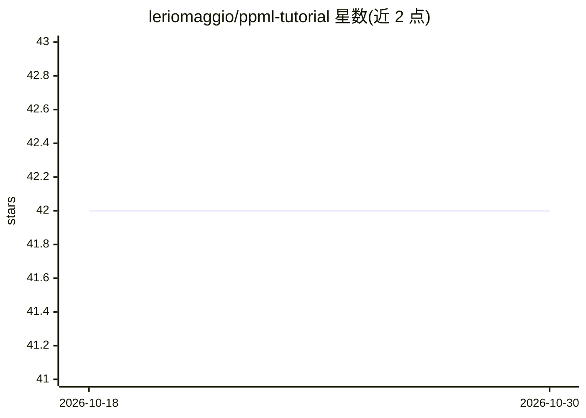

# leriomaggio/ppml-tutorial

⭐ 42 · Jupyter Notebook · Apache-2.0 · 推送 2025-12-08 · [GitHub](https://github.com/leriomaggio/ppml-tutorial) · 个人维护

**PyCon Italia 2024 隐私保护机器学习（PPML）教程材料库**

面向 PyCon Italia 2024 与会者的 PPML 工作坊材料仓库，以 Jupyter notebook 提供代码与讲义。内容分三部分：数据与模型隐私威胁（去标识化、K-匿名、成员推断攻击）、差分隐私（含 Opacus 的 PyTorch 差分隐私训练）、以及基于 PySyft 的远程数据科学与加密数据上的深度学习训练。无特定硬件要求，依赖标准 Python/PyData 栈及 PySyft、Opacus、PHE 等专用包，环境配置另见 setup.md。代码采用 Apache 许可，教学材料采用 CC BY 4.0。

## 筛选速览

| 维度 | 判定 | 备注 |
|---|---|---|
| AI 角色 | `ai-knowledge` | 知识聚合/清单类 |
| 许可风险 | `permissive` | Apache-2.0 |
| 部署形态 | `None` |  |
| 模型依赖 | — | README 未给出锁定关系 |
| 硬件要求 | — | 无带数字的原话,不猜 |
| 安装摩擦 | `low` | 无编译、无系统依赖或容器化 |
| 成熟度 | — | 结构信号不足 |

## 能力要点

- 三部分结构：隐私威胁、差分隐私、加密数据远程分析
- 使用 PySyft、Opacus、PHE 等专用库的实操 notebook
- 无特定硬件要求，可在普通笔记本运行

## 适用场景

- 学习差分隐私在机器学习中的应用
- 了解成员推断攻击等模型隐私威胁
- 上手 PySyft 联邦学习与加密数据训练

## 场景标签

`教程课程` · 领域:学习与行业

## 证据(README 行号)

> L3: Repository for the tutorial on **Privacy-Preserving Machine Learning** (`PPML`) presented at PyCon Italia 2024
> L59: All the materials in this tutorial (code, and lecture notes) are made available as

## 星数曲线

2026-10-18 42 → 2026-10-30 42（+0）

---
*卡片 v1 · prompt 1.4 · 生成 2026-10-25 · 置信度 high · 依据 README sha `2c3c6f31f8fa` · [字段定义](../../DATASET.md)*
