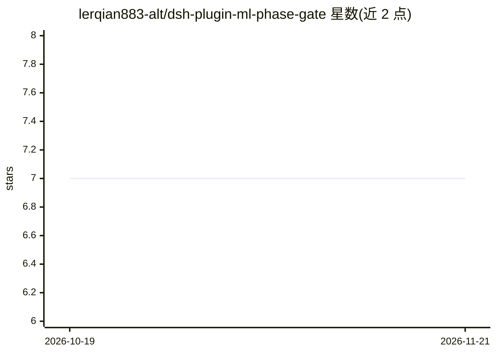

# lerqian883-alt/dsh-plugin-ml-phase-gate

⭐ 7 · JavaScript · MIT · 推送 2026-10-10 · [GitHub](https://github.com/lerqian883-alt/dsh-plugin-ml-phase-gate) · [官网](https://github.com/lerqian883-alt/dsh-plugin-ml-phase-gate#readme) · 个人维护 · 中文 README

**为 DeepSeek Harness 提供 ML 项目阶段证据闸门与可视化的插件**

面向使用 DeepSeek Harness 的机器学习项目，把 M0–M8 阶段流程接入 DSH 界面：读取项目声明的阶段，运行项目自身的验证脚本与检查，依据 phases.yml/state.json/outputs 等文件证据计算真实阶段、差距与下一出口，并在输入框上方展示阶段轨道、右栏展示审计页。提供 bootstrap 脚本初始化项目结构、四个 Agent 可调用工具（状态/定义/推进/人工覆盖）。插件本身不生成 ML 代码，也不判定阶段完成，需项目自备验证脚本；需要 Node.js 20+ 与可运行的 DSH profile。

## 筛选速览

| 维度 | 判定 | 备注 |
|---|---|---|
| AI 角色 | `ai-ecosystem` | LLM/agent 周边工具 |
| 许可风险 | `permissive` | MIT |
| 部署形态 | `None` |  |
| 模型依赖 | locked-api |  |
| 硬件要求 | — | 无带数字的原话,不猜 |
| 安装摩擦 | `low` | 无编译、无系统依赖或容器化 |
| 成熟度 | — | 结构信号不足 |

## 能力要点

- 基于项目文件证据计算真实阶段、差距与下一出口，而非依赖模型自述
- 在 DSH 界面显示 M0–M8 阶段轨道与审计页
- bootstrap 脚本一键生成 phases.yml/state.json/验证入口
- 提供 ml_phase_status/phases/advance/defer 四个 Agent 工具

## 适用场景

- ML 项目中核验数据处理、指标等阶段是否留下真实工件证据
- 在 DSH 会话中让 Agent 查询与推进项目阶段
- 为已有 ML 项目初始化带检查脚本的阶段流程结构

## 场景标签

`工作流自动化` · 领域:效率与自动化

## 证据(README 行号)

> L6: > 给 DeepSeek Harness 使用的机器学习阶段闸门插件：让“做到哪一步”不只靠模型自述，而是由检查、工件和项目状态共同证明。
> L12: 这个插件把 ML 项目拆成 M0–M8 阶段，并做三件事：

## 星数曲线

2026-10-19 7 → 2026-11-21 7（+0）

---
*卡片 v1 · prompt 1.4 · 生成 2026-11-20 · 置信度 high · 依据 README sha `30736f6b7b47` · [字段定义](../../DATASET.md)*
