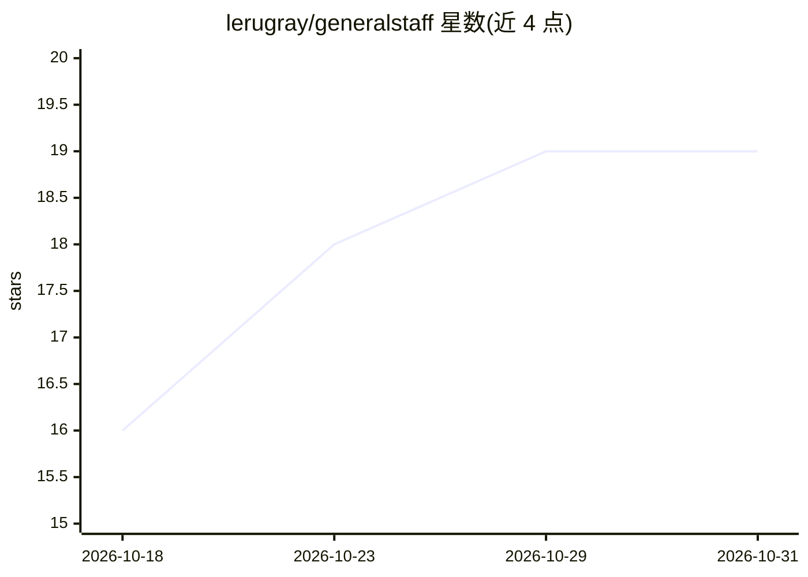

# lerugray/generalstaff

⭐ 19 · TypeScript · AGPL-3.0 · 推送 2026-10-28 · [GitHub](https://github.com/lerugray/generalstaff) · 个人维护

**面向自主编码 agent 的本地验证门调度器：测试不过即回滚**

BYOK、local-first 的自主编码 agent 调度器：以自然语言描述任务，由 AI engineer 在独立 worktree 分支执行，交付前必须通过验证门——运行项目自定的 verification_command、检查 diff 非空、并由独立 reviewer AI 确认符合任务范围与 hands_off 保护清单；任一失败即回滚。所有 prompt、响应、工具调用与 diff 写入 PROGRESS.jsonl 审计日志。可选层包括 autonomous 模式、Aides 常驻 agent、VS Code 扩展形式的 Workbench、本地 dashboard 与计划审计 CLI。安装经 curl 脚本（含 Windows PowerShell 版），依赖 bun。

## 筛选速览

| 维度 | 判定 | 备注 |
|---|---|---|
| AI 角色 | `ai-ecosystem` | LLM/agent 周边工具 |
| 许可风险 | `viral` | AGPL-3.0 |
| 部署形态 | `None` |  |
| 模型依赖 | — | README 未给出锁定关系 |
| 硬件要求 | — | 无带数字的原话,不猜 |
| 安装摩擦 | `low` | 无编译、无系统依赖或容器化 |
| 成熟度 | — | 结构信号不足 |

## 能力要点

- 验证门为代码而非提示：测试命令 + 非空 diff + 独立 reviewer 三重检查，失败回滚
- BYOK、无遥测、无托管层，全量审计日志写入 PROGRESS.jsonl
- changeset verify 可离线复核 Claude Code / Cursor 等其他 agent 已写的改动并出具绑定摘要的回执
- 可选层：autonomous 模式、Aides、VS Code Workbench、本地 dashboard

## 适用场景

- 让 AI agent 在我睡觉时完成受限任务，测试不过不进主分支
- 复核 Claude Code 或 Cursor 产出的未提交改动是否真的通过我的测试
- 以审计日志追踪 AI 每一步做了什么

## 场景标签

`编码 Agent` `Agent 框架` · 领域:Agent 开发

## 证据(README 行号)

> L5: GeneralStaff: a verification gate for autonomous coding agents. Your agent says the work is done; it doesn't get the
> L20: The gate is code, not a prompt. Every cycle runs `verification_command` (your tests), checks the diff is non-empty,
> L92: A wargame designer built this by treating AI failure modes as an adversarial rules problem: enumerate the bad outco

## 星数曲线

2026-10-18 16 → 2026-10-31 19（+3）

---
*卡片 v1 · prompt 1.4 · 生成 2026-10-28 · 置信度 high · 依据 README sha `3b45bc0ded3d` · [字段定义](../../DATASET.md)*
