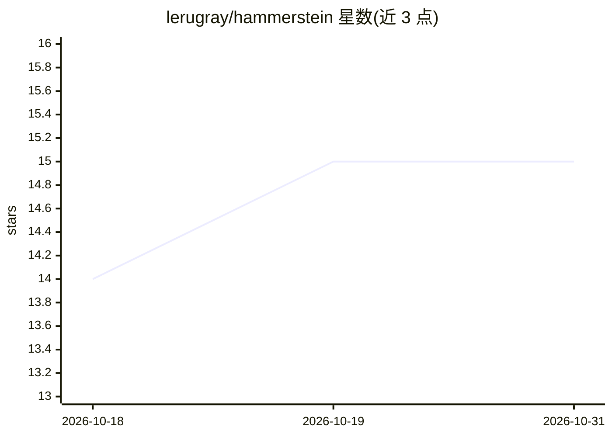

# lerugray/hammerstein

⭐ 15 · Python · MIT · 推送 2026-07-31 · [GitHub](https://github.com/lerugray/hammerstein) · 个人维护

**面向战略推演的推理框架与 CLI：可移植系统提示+检索语料+多模型路由**

把一套名为 Hammerstein 的推理纪律编码为可移植系统提示、少量样本模板、小型检索语料与 Python CLI harness，路由到任意模型（OpenRouter/DeepSeek/Ollama 等），换底层模型时推理风格保持不变。定位为只读推理/审计层：不编辑文件、不调用工具，拒绝方案时给出改变结论的条件。附交互式 shell hsh 与配套脚本，语料需用户自行替换。README 附带成对盲评基准数据，并声明在部分前沿模型上无提升或反转。

## 筛选速览

| 维度 | 判定 | 备注 |
|---|---|---|
| AI 角色 | `ai-ecosystem` | LLM/agent 周边工具 |
| 许可风险 | `permissive` | MIT |
| 部署形态 | `library` | 以包/库形式分发 |
| 模型依赖 | local-ok | 支持本地模型 |
| 硬件要求 | — | 无带数字的原话,不猜 |
| 安装摩擦 | `low` | 无编译、无系统依赖或容器化 |
| 成熟度 | — | 结构信号不足 |

## 能力要点

- 可移植系统提示+few-shot 模板+检索语料+Python harness 的组合
- providers.yaml 提供模型回退链（OpenRouter→DeepSeek→本地 Ollama）
- 5 个稳定模板接口（audit-this-plan 等），stdout/stderr 分离可解析
- 配套交互 shell hsh（限界上下文）与 h/hquery/hlog/hstats 脚本

## 适用场景

- 让 AI 对计划做推演式审计而非顺从式回答
- 在切换底层模型/供应商时保持一致的推理风格
- 自定义语料后用于自己项目的战略决策审查

## 场景标签

`模型网关` `提示工程` `RAG` · 领域:Agent 开发

## 证据(README 行号)

> L15: This repo is the **open-source framework and CLI**: the Hammerstein reasoning
> L18: you have. Point it at a frontier API, a cheap per-token endpoint, or a local
> L139: - **Not a code editor.** This repo does not edit files, run git, or call

## 星数曲线

2026-10-18 14 → 2026-10-31 15（+1）

---
*卡片 v1 · prompt 1.4 · 生成 2026-10-30 · 置信度 high · 依据 README sha `a4592ea99d78` · [字段定义](../../DATASET.md)*
