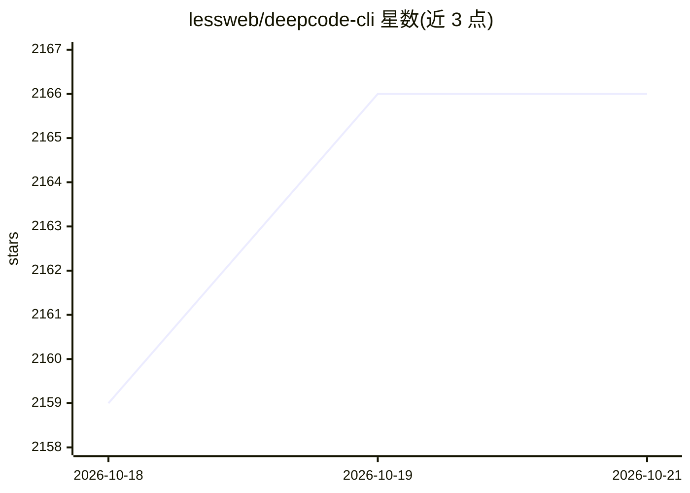

# lessweb/deepcode-cli

⭐ 2,166 · TypeScript · MIT · 推送 2026-10-15 · [GitHub](https://github.com/lessweb/deepcode-cli) · [官网](https://deepcode.vegamo.cn) · 组织维护 · 中文 README

**为 DeepSeek 模型优化的终端 AI 编码助手**

基于 npm 分发的命令行 AI 编码助手，工具链针对 DeepSeek 模型调优：支持思考模式与推理强度控制（/model 切换）、上下文缓存降本、Agent Skills 多级目录扫描（.deepcode/.agents）、MCP 外接 GitHub/浏览器/数据库、细粒度权限确认、图片理解（多模态内联或 Files API）、联网搜索与任务完成通知脚本。配置文件与官方 VSCode 插件共享，另提供可选订阅服务 DeepCode Plus（含图片/视频生成等），不订阅亦可使用全部基础功能。

## 筛选速览

| 维度 | 判定 | 备注 |
|---|---|---|
| AI 角色 | `ai-native` | 本体是模型或模型工具 |
| 许可风险 | `permissive` | MIT |
| 部署形态 | `library` | 以包/库形式分发 |
| 模型依赖 | locked-api |  |
| 硬件要求 | — | 无带数字的原话,不猜 |
| 安装摩擦 | `low` | 无编译、无系统依赖或容器化 |
| 成熟度 | — | 结构信号不足 |

## 能力要点

- 针对 DeepSeek 模型调优的 harness，支持思考模式与推理强度控制
- Agent Skills 按 Project/User 四级目录扫描，跨客户端互操作
- MCP 集成连接 GitHub、浏览器、数据库等外部服务
- 细粒度权限控制（Shell/文件/网络操作前确认）

## 适用场景

- 在终端中让 AI 助手编写和修改代码
- 通过 Skills 与 MCP 扩展助手能力
- 在 VSCode 与终端间共享配置切换使用

## 场景标签

`编码 Agent` · 领域:编码与开发

## 证据(README 行号)

> L12: Deep Code 是专为 `deepseek-v4` 模型优化的终端 AI 编码助手，支持深度思考、推理强度控制、Agent Skills 以及 MCP 集成。
> L53: ### **为 DeepSeek 优化**

## 星数曲线

2026-10-18 2,159 → 2026-10-21 2,166（+7）

---
*卡片 v1 · prompt 1.4 · 生成 2026-10-21 · 置信度 high · 依据 README sha `de83a3ef58c7` · [字段定义](../../DATASET.md)*
