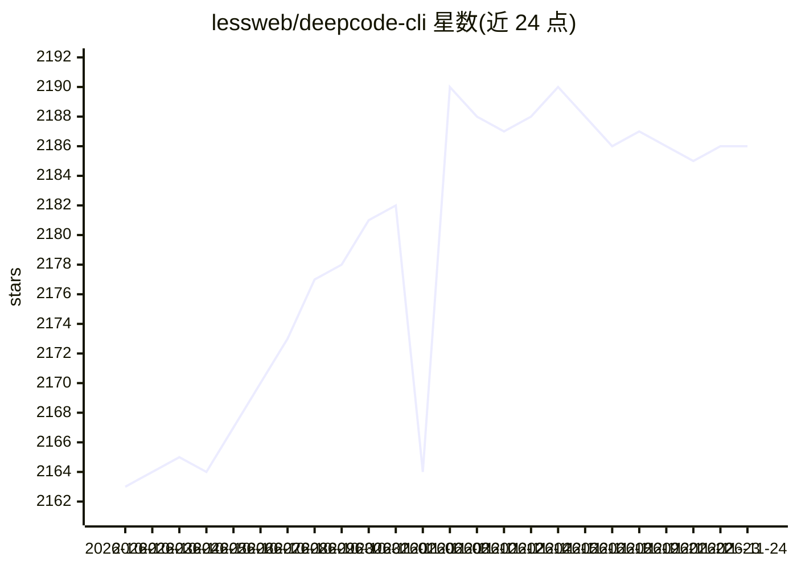

# lessweb/deepcode-cli

⭐ 2,188 · TypeScript · MIT · 推送 2026-11-13 · [GitHub](https://github.com/lessweb/deepcode-cli) · [官网](https://deepcode.vegamo.cn) · 组织维护 · 中文 README

**面向开发者的 DeepSeek 优化终端 AI 编码助手**

以 npm 全局包发布的终端 AI 编码助手，专为 DeepSeek 模型调优。提供 agent skills 扩展机制（扫描项目/用户级目录，兼容 .agents/skills 跨客户端互操作）、思考模式与推理强度控制、MCP 外部服务集成、细粒度权限确认、斜杠命令与会话管理，并支持读取本地图片与可选的联网搜索。CLI 与官方 VSCode 插件共享同一配置文件；另有可选的 DeepCode Plus 订阅套餐，不订阅也可使用。

## 筛选速览

| 维度 | 判定 | 备注 |
|---|---|---|
| AI 角色 | `ai-native` | 本体是模型或模型工具 |
| 许可风险 | `permissive` | MIT |
| 部署形态 | `library` | 以包/库形式分发 |
| 模型依赖 | locked-api |  |
| 硬件要求 | — | 无带数字的原话,不猜 |
| 安装摩擦 | `low` | 无编译、无系统依赖或容器化 |
| 成熟度 | — | 结构信号不足 |

## 能力要点

- Agent Skills 支持，扫描 .deepcode/skills 与跨客户端 .agents/skills 目录
- 专为 DeepSeek 优化的思考模式与推理强度控制
- MCP 集成可连接 GitHub、浏览器、数据库等外部服务
- 细粒度权限控制与 /undo 状态回退

## 适用场景

- 在终端中用 DeepSeek 模型进行代码对话与修改
- 通过 skills 与 MCP 扩展助手的工具能力
- 接入 OpenAI 兼容接口或 Coding Plan 使用其他模型

## 场景标签

`编码 Agent` · 领域:编码与开发

## 证据(README 行号)

> L12: Deep Code 是专为 `deepseek-v4` 模型优化的终端 AI 编码助手，支持深度思考、推理强度控制、Agent Skills 以及 MCP 集成。
> L99: Armin Ronacher 在《Better Models: Worse Tools》中指出，工具 schema 不是「中立的」：模型（LLM）会继承训练和强化学习中形成的工具使用习惯，因此可能在某个主流 harness 中表现

## 星数曲线

2026-10-22 2,163 → 2026-11-24 2,186（+23）

---
*卡片 v1 · prompt 1.4 · 生成 2026-11-23 · 置信度 high · 依据 README sha `2b1dad25ca61` · [字段定义](../../DATASET.md)*
