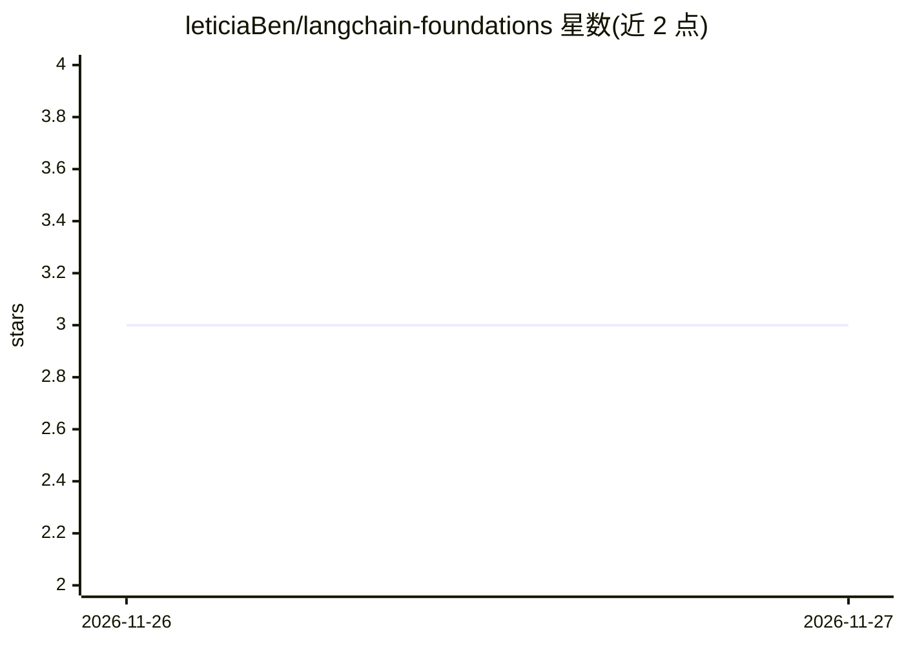

# leticiaBen/langchain-foundations

⭐ 3 · Jupyter Notebook · MIT · 推送 2026-10-31 · [GitHub](https://github.com/leticiaBen/langchain-foundations) · 个人维护

**LangChain Academy 课程的 Python Agent 学习实践仓库**

作者学习 LangChain Academy《Introduction to LangChain (Python)》课程的动手实践副本，课程材料（notebook、练习、MIT 许可）来自 langchain-ai/lca-lc-foundations。覆盖三个模块：创建 Agent（多提供商聊天模型、工具调用、短期记忆、多模态消息）、进阶 Agent（MCP、多智能体、RAG、SQL Agent）、生产化 Agent（中间件、长对话管理、human-in-the-loop）。配套 Personal Chef、Wedding Planner、Email Assistant 三个实践项目，README 保留完整的环境搭建指南。

## 筛选速览

| 维度 | 判定 | 备注 |
|---|---|---|
| AI 角色 | `ai-knowledge` | 知识聚合/清单类 |
| 许可风险 | `permissive` | MIT |
| 部署形态 | `library` | 以包/库形式分发 |
| 模型依赖 | locked-api |  |
| 硬件要求 | — | 无带数字的原话,不猜 |
| 安装摩擦 | `low` | 无编译、无系统依赖或容器化 |
| 成熟度 | — | 结构信号不足 |

## 能力要点

- 三个实践项目：Personal Chef、Wedding Planner、Email Assistant
- 覆盖 MCP、supervisor 多智能体、RAG、中间件与 human-in-the-loop 审批
- 提供 uv 与 pip 两条环境安装路径及环境自检脚本 env_utils.py
- LangGraph Server/Studio 可视化运行调试，LangSmith 跟踪观测（可选）

## 适用场景

- 按课程模块学习用 LangChain v1 与 LangGraph 构建 Agent
- 参考 Email Assistant 项目实现带人工审批的邮件草拟流程
- 在自己的项目中复用课程的多智能体（supervisor/sub-agent）模式

## 场景标签

`教程课程` · 领域:学习与行业

## 证据(README 行号)

> L3: My hands-on work through LangChain Academy's **Introduction to LangChain (Python)** course. I use this repo to learn
> L5: > The course material (notebooks, exercises, MIT license) comes from langchain-ai/lca-lc-foundations. This repo is m
> L151: This repository contains three Modules that serve as introductions to many of LangChain's most-used features.

## 星数曲线

2026-11-26 3 → 2026-11-27 3（+0）

---
*卡片 v1 · prompt 1.4 · 生成 2026-11-26 · 置信度 high · 依据 README sha `ea3947b1fd84` · [字段定义](../../DATASET.md)*
