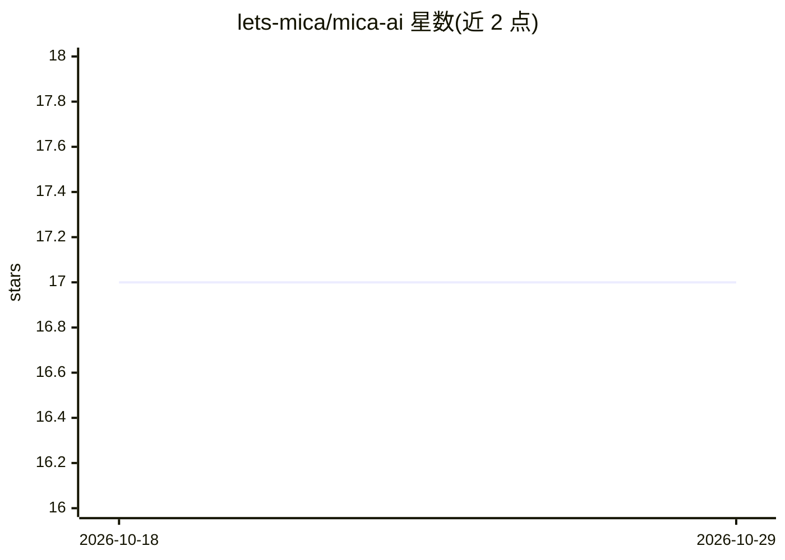

# lets-mica/mica-ai

⭐ 17 · Java · Apache-2.0 · 推送 2026-10-25 · [GitHub](https://github.com/lets-mica/mica-ai) · [官网](https://www.dreamlu.net) · 组织维护 · 中文 README

**面向 Java 生态的多模型 AI 推理工具箱，JVM 内直接运行**

Mica AI 为 Java 工程师提供纯 Java 推理的 AI 能力模块：基于 ONNX Runtime 在 JVM 内运行，无需 Python 进程。能力覆盖 YuNet/SFace 人脸检测与 128d 特征、活体检测、Magika 214 类文件类型识别、HyperLPR3 中国车牌识别、PP-DocLayoutV3 文档版面分析、U²-Net 抠图、文本行方向分类与 ddddocr 验证码识别。以 Maven 依赖分发，提供 Spring Boot Starter 一行 YAML 注入 Bean，也支持零 Spring 的纯 Java 8+ 核心。部分模型随仓库分发，部分需外置配置。

## 筛选速览

| 维度 | 判定 | 备注 |
|---|---|---|
| AI 角色 | `ai-native` | 本体是模型或模型工具 |
| 许可风险 | `permissive` | Apache-2.0 |
| 部署形态 | `None` |  |
| 模型依赖 | — | README 未给出锁定关系 |
| 硬件要求 | — | 无带数字的原话,不猜 |
| 安装摩擦 | `medium` | 含编译或系统依赖之一 |
| 成熟度 | — | 结构信号不足 |

## 能力要点

- 纯 Java + ONNX Runtime 推理，无需 Python 进程与 PyTorch
- 10 类能力模块（人脸/文件类型/车牌/版面/抠图/文本行方向/验证码等）
- Spring Boot Starter 一行 YAML 注入引擎 Bean，核心模块支持零 Spring
- 模型直接入库，克隆即用；各模型 License 标注可商用

## 适用场景

- Java 项目中直接集成人脸识别、门禁或考勤
- 停车场、道闸场景的中国车牌识别
- PDF/文档预处理与版面阅读顺序分析
- 文件上传场景的 MIME 推断与内容审计

## 场景标签

`人脸识别` `文档解析` `OCR` `图像视频处理` · 领域:知识与检索

## 证据(README 行号)

> L3: ### 让 Java 工程师也能玩转主流 AI 模型 —— **零 Python · 零 PyTorch · 纯 ONNX Runtime**
> L36: |🎭 人脸检测|`mica-ai-face`|YuNet|人脸框 + 5 关键点|Apache 2.0|✅|

## 星数曲线

2026-10-18 17 → 2026-10-29 17（+0）

---
*卡片 v1 · prompt 1.4 · 生成 2026-10-29 · 置信度 high · 依据 README sha `f41ae373d935` · [字段定义](../../DATASET.md)*
