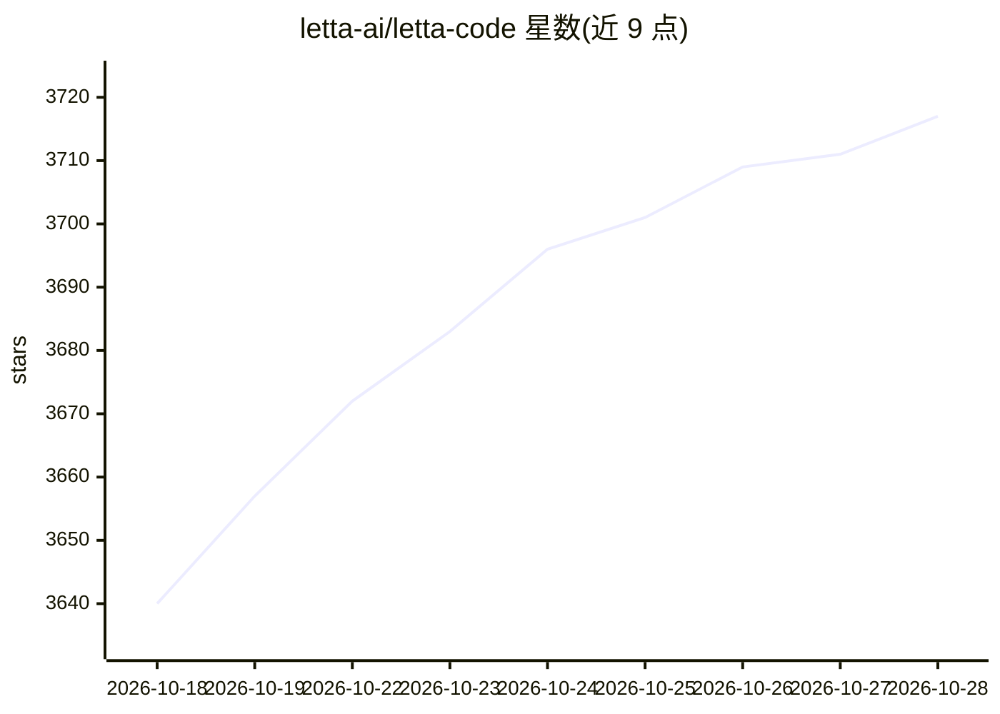

# letta-ai/letta-code

⭐ 3,717 · TypeScript · Apache-2.0 · 推送 2026-10-27 · [GitHub](https://github.com/letta-ai/letta-code) · [官网](https://www.letta.com/agent) · 组织维护

**给开发者的有状态 agent 运行框架：记忆、自我改写与多端交互**

Letta Code 是一个有状态 agent harness，用于创建具有记忆、身份与长期经验的 agent：agent 可改写自身记忆块、技能、系统提示乃至 harness 本身（通过 mods）。支持 CLI 本地运行、浏览器（chat.letta.com）与 Slack/Telegram/Discord 等消息渠道交互，并提供 MemFS（git 跟踪上下文）、子 agent、hooks、权限、定时任务、跨机器远程执行等功能。默认连接 Letta Cloud，也可本地后端运行，通过 /connect 配置自有 LLM API key。由 MemGPT 创建者团队开发。

## 筛选速览

| 维度 | 判定 | 备注 |
|---|---|---|
| AI 角色 | `ai-ecosystem` | LLM/agent 周边工具 |
| 许可风险 | `permissive` | Apache-2.0 |
| 部署形态 | `library` | 以包/库形式分发 |
| 模型依赖 | — | README 未给出锁定关系 |
| 硬件要求 | — | 无带数字的原话,不猜 |
| 安装摩擦 | `low` | 无编译、无系统依赖或容器化 |
| 成熟度 | — | 结构信号不足 |

## 能力要点

- agent 通过改写记忆块、技能与提示实现自我改进（/sleeptime、/dream、/palace）
- MemFS：全部上下文（含记忆块）由 git 跟踪，可同步到 GitHub 仓库
- 多通道交互：本地 CLI、浏览器（含移动端）、Slack/Telegram/Discord
- 跨机器运行：letta server 将任意机器接入，agent 可路由到指定计算机

## 适用场景

- 搭建具有长期记忆与自我改进能力的编码/工作 agent
- 运行始终在线、按计划主动工作的 agent
- 在不同设备（笔记本、云 VM、Mac Mini）上延续同一个 agent 的状态

## 场景标签

`Agent 记忆` `Agent 框架` · 领域:Agent 开发

## 证据(README 行号)

> L5: Letta Code is a stateful agent harness for creating agents that are more like people than tools. Letta Code agents h
> L124: Letta Code is developed by the creators of MemGPT and sleep-time compute (now called "dreaming"), and driven by ou

## 星数曲线

2026-10-18 3,640 → 2026-10-28 3,717（+77）

---
*卡片 v1 · prompt 1.4 · 生成 2026-10-20 · 置信度 high · 依据 README sha `05613eed6d1b` · [字段定义](../../DATASET.md)*
