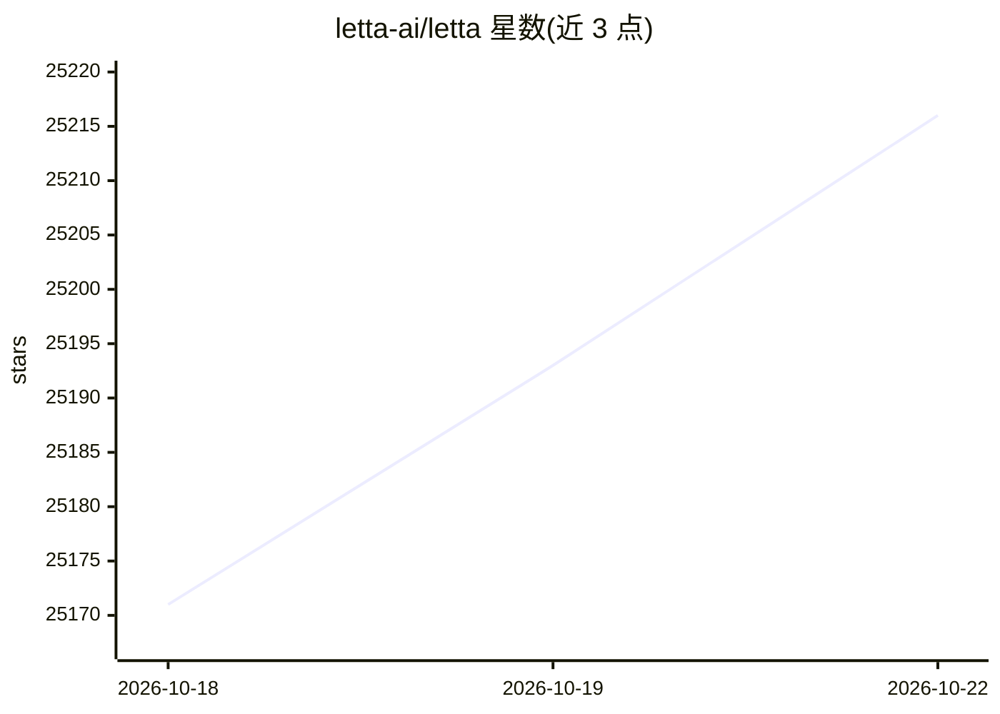

# letta-ai/letta

⭐ 25,216 · Apache-2.0 · 推送 2026-10-18 · [GitHub](https://github.com/letta-ai/letta) · [官网](https://docs.letta.com/) · 组织维护

**构建带持久记忆、可自我改进的有状态 AI agent 平台**

Letta（前身为 MemGPT）提供构建有状态 agent 的平台：agent 具备可随时间学习和改进的记忆能力。当前源码位于 letta-ai/letta-code，包含 agent 运行框架、交互式终端 UI、App Server、channels 及桌面/网页应用所用运行时。通过 npm 全局安装 @letta-ai/letta-code 后可用 letta 命令启动终端 UI，或 letta server 运行本地/自托管 App Server；也可通过浏览器、Slack/Telegram/Discord、TypeScript Agent SDK 及 Letta Cloud 使用。archive 分支保留已退役的 V1 API 服务器。

## 筛选速览

| 维度 | 判定 | 备注 |
|---|---|---|
| AI 角色 | `ai-ecosystem` | LLM/agent 周边工具 |
| 许可风险 | `permissive` | Apache-2.0 |
| 部署形态 | `library` | 以包/库形式分发 |
| 模型依赖 | — | README 未给出锁定关系 |
| 硬件要求 | — | 无带数字的原话,不猜 |
| 安装摩擦 | `low` | 无编译、无系统依赖或容器化 |
| 成熟度 | — | 结构信号不足 |

## 动量与使用信号

- 维护:`active` — 距上次 push 37.6 天,年发版 12,139 位贡献者
- 涨星:近 1 天 **+11**(自 20261016 起算)
- 安装:npm 包 `@letta-ai/letta-code` 月下载 653,521
- 平台:WINDOWS / MACOS / LINUX · 协议:—

## 能力要点

- agent 具备可持久化并随时间学习的记忆
- npm 安装后提供交互式终端 UI 与本地 App Server
- 支持 Slack/Telegram/Discord 等渠道接入
- 提供 TypeScript Agent SDK 与 Letta Cloud

## 适用场景

- 构建需要长期记忆与自我改进的 AI agent
- 在本地或自托管环境运行 agent 服务
- 通过 Slack/Telegram 等聊天渠道使用 agent

## 场景标签

`Agent 框架` `Agent 记忆` · 领域:Agent 开发

## 证据(README 行号)

> L3: Build stateful agents with memory that can learn and improve over time.
> L5: Letta (f.k.a. MemGPT) is actively developed. The current source code lives in `letta-ai/letta-code`, which includes 

## 星数曲线

2026-10-18 25,171 → 2026-10-22 25,216（+45）

---
*卡片 v1 · prompt 1.4 · 生成 2026-10-20 · 置信度 high · 依据 README sha `220423b81b64` · [字段定义](../../DATASET.md)*
