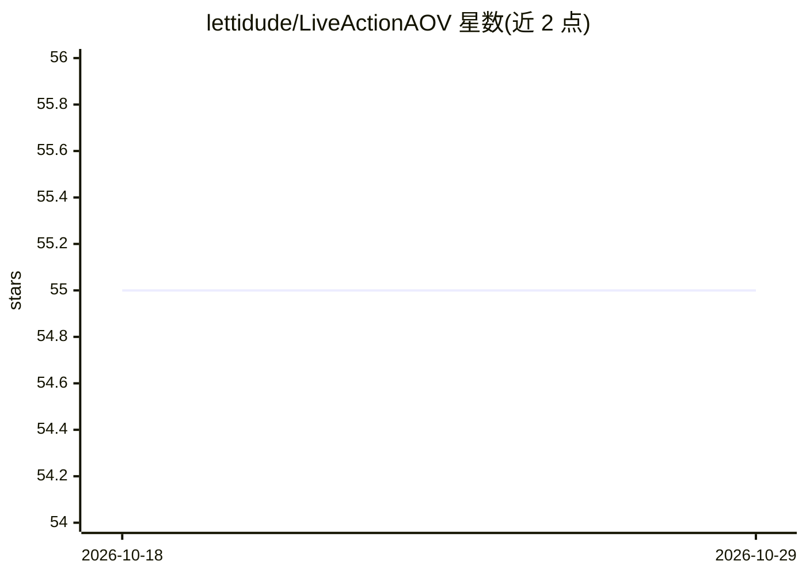

# lettidude/LiveActionAOV

⭐ 55 · Python · MIT · 推送 2026-10-28 · [GitHub](https://github.com/lettidude/LiveActionAOV) · [官网](https://youtu.be/HnosSnK1MKs) · 个人维护

**为实拍 VFX 镜头生成深度/法线/运动/遮罩 AOV 的 AI 工具**

面向 VFX 合成流程的工具：读取 EXR 图像序列，运行深度、法线、运动向量、遮罩、Cryptomatte、世界坐标与 AO 等 pass，输出 Nuke 通道规范的 sidecar EXR，原始 plate 不被修改。模型栈包括 Depth Anything V2、DSINE、RAFT、SAM 3、RVM 等，首次运行从 Hugging Face 下载 1.5–12 GB 权重，SAM 3 需一次性 HF token。提供 GUI 与 CLI，附 Nuke 节点 UtilityRelight。自述处于 alpha 阶段；CPU-only 不受支持，fp16 模型仅限 CUDA。

## 筛选速览

| 维度 | 判定 | 备注 |
|---|---|---|
| AI 角色 | `ai-native` | 本体是模型或模型工具 |
| 许可风险 | `permissive` | MIT |
| 部署形态 | `desktop` | 安装包/桌面程序 |
| 模型依赖 | — | README 未给出锁定关系 |
| 硬件要求 | `cpu-ok` | |
| 安装摩擦 | `medium` | 含编译或系统依赖之一 |
| 成熟度 | `idea` | |

## 能力要点

- 读取 EXR 序列，输出含 Z/N/motion/matte/Cryptomatte/P/AO 通道的 sidecar EXR
- SAM 3 点击追踪 + BiRefNet 细化生成交互式软边 Cryptomatte 遮罩
- 附带 Nuke 节点 UtilityRelight（BlinkScript GPU 重光）
- 每个模型在 GUI 内显示许可徽章，EXR 携带许可元数据供下游审计

## 适用场景

- 实拍镜头快速获得深度、法线、运动向量等合成用 AOV
- 用少量点击生成逐对象 Cryptomatte 与软边 roto 遮罩
- 在 Nuke 中对实拍主体做 3D 灯光放置

## 场景标签

`图像视频处理` · 领域:感知与多模态

## 证据(README 行号)

> L5: **AI-driven AOV pass generator for VFX plates.** Reads EXR image sequences, runs depth / normals / motion / matte pa
> L39: > **First run downloads model checkpoints from Hugging Face.** Expect

## 星数曲线

2026-10-18 55 → 2026-10-29 55（+0）

---
*卡片 v1 · prompt 1.4 · 生成 2026-10-24 · 置信度 high · 依据 README sha `7c54652f87b9` · [字段定义](../../DATASET.md)*
