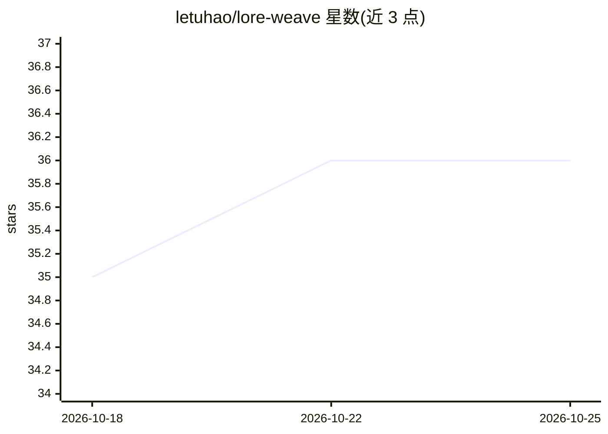

# letuhao/lore-weave

⭐ 36 · Python · AGPL-3.0 · 推送 2026-10-05 · [GitHub](https://github.com/letuhao/lore-weave) · [官网](https://github.com/letuhao/lore-weave/blob/main/README.md) · 个人维护

**面向小说作者与世界构建者的自托管 AI 共创写作平台**

自托管的小说创作平台，核心机制是从已写章节自动抽取角色、地点、事件与关系构建知识图谱，使 AI 聊天、翻译与共写建议均锚定于作者设定。翻译管线结合术语表与多智能体校验（命名漂移、句数、语义），支持跨章节译名延续。BYOK 模型接入（OpenAI/Anthropic/LM Studio/Ollama），AGPL v3 许可，提供 Docker Compose 部署与可停靠的 Writing Studio 工作区；部分功能（共写批评器、Campaigns）标注为进行中的路线图阶段。

## 筛选速览

| 维度 | 判定 | 备注 |
|---|---|---|
| AI 角色 | `ai-native` | 本体是模型或模型工具 |
| 许可风险 | `viral` | AGPL-3.0 |
| 部署形态 | `self-host` | docker 或自建部署 |
| 模型依赖 | local-ok | 支持本地模型 |
| 硬件要求 | — | 无带数字的原话,不猜 |
| 安装摩擦 | `low` | 无编译、无系统依赖或容器化 |
| 成熟度 | `idea` | |

## 能力要点

- 从章节自动抽取实体与关系构建知识图谱，作为 AI 长期记忆
- 知识锚定的多语言批量翻译，含规则层+LLM 语义双校验与译名延续
- BYOK 模型无关接入，经统一 provider 网关路由所有 AI 调用
- Writing Studio 可停靠/弹出面板工作区与 MCP 网关支持外部 agent 访问

## 适用场景

- 长篇小说写作中让 AI 记住全部角色与设定的连贯共创
- 保持自创术语与角色译名一致的多语言小说翻译
- 世界设定（lore）管理、实体抽取与矛盾检查

## 场景标签

`AI 写作` `知识图谱` `知识库管理` `Agent 记忆` · 领域:Agent 开发

## 证据(README 行号)

> L24: Every chapter you write, LoreWeave automatically extracts every character, location, event, and relationship into a
> L46: LoreWeave is self-hosted and model-agnostic. Bring your own API keys from OpenAI, Anthropic, or any provider. Run e
> L162: - BYOK: OpenAI, Anthropic, LM Studio, Ollama, any OpenAI-compatible endpoint

## 星数曲线

2026-10-18 35 → 2026-10-25 36（+1）

---
*卡片 v1 · prompt 1.4 · 生成 2026-10-25 · 置信度 high · 依据 README sha `962702583945` · [字段定义](../../DATASET.md)*
